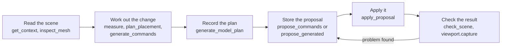

# Assistant tools: reference

This folder documents every tool the modeling assistant can call. There is one page per tool, with its input, its result, a worked example and a small diagram. The examples are also shown as live demos in [`demos/index.html`](demos/index.html), grouped into tabs by tool type.

The examples are checked against the code. `apps/backend/src/modules/tools/tool-docs.spec.ts` runs the real tools on the sample scene below and compares the results with the examples. If a tool changes and its example does not, that test fails.

[`docs/assistant-tools.md`](../assistant-tools.md) remains the full inventory, with the editor command table and the approval rules.

## Tool types

The tool types follow the permission each tool declares in `TOOL_PERMISSIONS` (`modules/tools/tool.types.ts`). The demo page has one tab per type.

| Type | Tab | What it does | Tools |
| --- | --- | --- | --- |
| `read` (inspect) | Read | Looks at the scene. Changes nothing. | [`editor.get_context`](editor.get_context.md), [`editor.get_scene_summary`](editor.get_scene_summary.md), [`editor.inspect_mesh`](editor.inspect_mesh.md), [`editor.inspect_materials`](editor.inspect_materials.md), [`viewport.capture`](viewport.capture.md), [`validation.check_scene`](validation.check_scene.md) |
| `read` (calculate) | Read | Works out a result from the scene. Changes nothing. | [`editor.measure`](editor.measure.md), [`editor.plan_placement`](editor.plan_placement.md), [`editor.plan_duplicates`](editor.plan_duplicates.md), [`modeling.generate_commands`](modeling.generate_commands.md) |
| `plan` | Plan | Records intent and the steps for a task. Changes nothing. | [`modeling.generate_model_plan`](modeling.generate_model_plan.md) |
| `propose` | Propose | Stores a batch of commands for review. The scene is not changed yet. | [`editor.propose_commands`](editor.propose_commands.md), [`modeling.propose_generated`](modeling.propose_generated.md) |
| `apply` | Apply | Applies a stored proposal to the scene. | [`editor.apply_proposal`](editor.apply_proposal.md) |
| `skill` | Skill | Loads the workflow for a skill selected for this request. | [`skills.load_skill`](skills.load_skill.md) |

There are fifteen tools in total. Thirteen of them read or write through the connected desktop editor, so they need an editor to run. The planning and skill tools (`modeling.generate_model_plan` and `skills.load_skill`) do not. In the demo page, five examples are marked `Live editor`, because their output is made by the editor itself (mesh geometry, material data, rendered pictures, measurements and applied history). Their examples show the shape of the result only. The other ten are marked `Checked by tests`: the backend computes them from the editor's snapshot, and the test suite checks them.

## How a change happens

Three rules hold for every path:

1. **Only `editor.apply_proposal` changes the scene.** Every other tool reads, calculates, plans or stores. Applying is automatic: there is no approval prompt for assistant proposals.
2. **A calculated batch is strict.** Pass `expectedRevision` (from `sourceRevision` or the revision you read). If the scene changes before the proposal is applied, the proposal fails and must be made again rather than being moved onto the new scene.
3. **Failures come back to the model.** A tool that fails returns `{ "error": "...", "details": ... }` so the model can correct the call. The run keeps going.

## The sample scene

Every example in this folder and in the demo page uses this scene, at revision 12, with `crate` selected.

| Object | id | Type | Parent | World bounds (min → max) |
| --- | --- | --- | --- | --- |
| Figure | `figure` | `empty` (group) | none | `[-1.05, 0.25, -0.3]` → `[1.05, 1.8, 0.3]` |
| Torso | `torso` | `mesh` | `figure` | `[-0.5, 0.25, -0.3]` → `[0.5, 1.75, 0.3]` |
| Arm (left) | `arm_left` | `mesh` | `figure` | `[-1.05, 0.6, -0.15]` → `[-0.75, 1.8, 0.15]` |
| Arm (right) | `arm_right` | `mesh` | `figure` | `[0.75, 0.6, -0.15]` → `[1.05, 1.8, 0.15]` |
| Crate | `crate` | `mesh` | none | `[2.5, 0, -0.5]` → `[3.5, 1, 0.5]` |
| Props | `props` | `empty` (group) | none | no geometry |

The two arms share the name `Arm` under the same parent, which `validation.check_scene` reports as a warning. `Props` has no children, which it reports as information. The full snapshot is in the Read tab of the demo page.

## Conventions

- **Identifiers** match `[A-Za-z0-9_-]{1,64}`. Object and collection ids are separate.
- **Revisions** are nonnegative integers. Every read reports one, and calculated or proposed batches refer back to it.
- **Mesh paths** name a mesh inside an imported object. Each step is a part name (`Arm`), a repeat (`Arm#1`, the second one) or a child index. Use the paths the inspection returns.
- **Vectors** are `[x, y, z]` in scene units. Positions are local to the parent unless a tool says `world`.
- **Matrices** are 16 numbers, column-major.
- **Units** are scene units unless the project is calibrated, in which case `measurementUnits` says how many meters one scene unit is.
