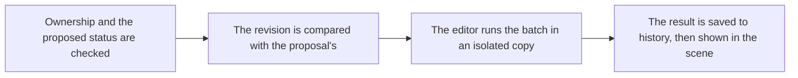

# `editor.apply_proposal`

> Applies a stored proposal to the editor. editor.propose_commands and modeling.propose_generated with apply true run this same step in one call. The commands join the project history, so the user can undo them.

| | |
| --- | --- |
| Provider name | `editor__apply_proposal` |
| Type | Apply (permission `apply`) |
| Approval | Never. Assistant proposals apply automatically. |
| Needs the editor | Yes |
| Example | Live editor output; the test checks its shape |
| Defined in | `apps/backend/src/modules/tools/editor/editor.tools.ts` |
| In the app | Documentation → Assistant tools → Apply |

## When the assistant uses it

- Right after a successful propose call, whose nextAction says so.
- After viewport.capture has shown the proposal to be right.

## Input

| Name | Type | Required | Default | Meaning |
| --- | --- | --- | --- | --- |
| `proposalId` | identifier | Yes | – | The id returned by the propose call. |

## Outcomes

| Item | Meaning |
| --- | --- |
| `status: applied` | The batch ran. revision is the scene revision afterwards. |
| `status: failed` | The scene was not changed. The message says why. |
| `rebased: true` | The scene had changed, and a non-strict batch was checked again and ran on the new scene. |
| `results[].name` | The name an object received. A name already used by a sibling gets a number, so read this value. |

## Result

| Field | Meaning |
| --- | --- |
| `proposalId, status, revision` | Which proposal, whether it applied, and the revision afterwards. |
| `results[]` | One entry per command: commandId, status, message and name when relevant. |
| `message, rebased` | Why it failed, if it did, and whether the batch was rebased. |

## Example

Request:

```json
{
  "proposalId": "prp_7e2b9c4d1a6f4b08"
}
```

Result:

```json
{
  "proposalId": "prp_7e2b9c4d1a6f4b08",
  "status": "applied",
  "revision": 13,
  "message": null,
  "rebased": false,
  "results": [
    {
      "commandId": "raise",
      "status": "applied",
      "message": null
    },
    {
      "commandId": "rename",
      "status": "applied",
      "message": null,
      "name": "Supply crate"
    }
  ]
}
```

## How it fits



## Tips

- Read results[].name rather than assuming the name you asked for.
- Undo is the user's. The assistant cannot undo its own change.

## Limits

- There is no approval prompt for assistant proposals.
- A failed batch leaves the scene unchanged.
- A batch is capped at 200 commands.

## Errors you may see

| Message | Cause |
| --- | --- |
| `The scene changed after this proposal was made (revision 12 → 13), and these commands only apply to the revision they were written for.` | A strict proposal (with expectedRevision, or geometry, material or copy commands) saw a changed scene. |
| `The scene changed after this proposal was made (revision 12 → 13), and it no longer fits: raise: …` | A command no longer fits the scene. Each problem is listed by commandId. |
| `Scene changed since these commands were calculated. Regenerate and propose again.` | A command no longer fits the scene after a rebase. |

## Related

- [`editor.propose_commands`](editor.propose_commands.md)
- [`modeling.propose_generated`](modeling.propose_generated.md)
- [`validation.check_scene`](validation.check_scene.md)
