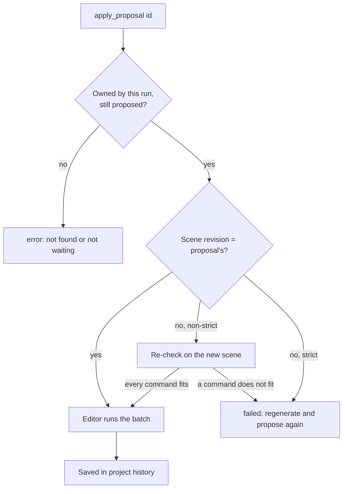

# `editor.apply_proposal`

Applies a stored proposal to the editor. This is the only assistant tool that changes the scene. The commands run in order, become part of the project history (so they can be undone), and the result reports each command's outcome and any name the editor gave an object.

| | |
| --- | --- |
| Provider name | `editor__apply_proposal` |
| Permission | `apply` |
| Approval | Never. Assistant proposals apply automatically. |
| Needs the editor | Yes |
| Defined in | `apps/backend/src/modules/tools/editor/editor.tools.ts` |
| Demo | [Apply tab](demos/index.html#apply) |

## When the assistant uses it

Immediately after a successful `editor.propose_commands` or `modeling.propose_generated` (their results say so with `nextAction`), unless the user asked for a review first. It is the step after [`viewport.capture`](viewport.capture.md) has shown the proposal to be right.

## Input

| Field | Type | Required | Meaning |
| --- | --- | --- | --- |
| `proposalId` | identifier | yes | The id returned by the propose call. |

## Result

```json
{
  "proposalId": "prp_7e2b9c4d1a6f4b08",
  "status": "applied",
  "revision": 13,
  "message": null,
  "rebased": false,
  "results": [
    { "commandId": "raise", "status": "applied", "message": null },
    { "commandId": "rename", "status": "applied", "message": null, "name": "Supply crate" }
  ]
}
```

- `status`: `applied` or `failed`.
- `revision`: the scene revision after the change.
- `rebased`: `true` when the scene had changed and a non-strict batch was checked again and ran on the new scene.
- `results[].name`: the name an object received when a command created, renamed or re-parented it. A name already used by a sibling gets a number, so read this rather than assuming the name you asked for.

## Example

Request:

```json
{ "proposalId": "prp_7e2b9c4d1a6f4b08" }
```

Result: the JSON above. The crate is now at `[3, 2.5, 0]` and named `Supply crate`, at revision 13.

## Visual example

```text
prp_7e2b9c4d1a6f4b08    proposed ──► applying ──► applied (revision 12 → 13)

  raise   applied
  rename  applied   → "Supply crate"

  History: one undo step reverts both commands.
```

## How it fits



The apply is prepared in a separate copy first, saved with the project, and only then shown in the scene. A failed batch leaves the scene unchanged.

## Limits and errors

- An unknown or foreign proposal id fails the ownership and lookup checks. It never opens an approval prompt.
- A strict proposal (one written with `expectedRevision`, or with geometry, material or hierarchy commands) fails when the scene changed. The model should read the scene, calculate again, and propose.
- A non-strict proposal may be applied after a rebase. Its absolute values win: a transform sets the position, even over a move the user made in between. Relative moves (`scene.move_object`) keep the user's move.
- A batch is capped at 200 commands.
- Undo and redo are the user's; the assistant cannot undo its own change.

## Related

- [`editor.propose_commands`](editor.propose_commands.md) and [`modeling.propose_generated`](modeling.propose_generated.md), which create the proposal.
- [`validation.check_scene`](validation.check_scene.md) and [`editor.measure`](editor.measure.md), to check the result afterwards.
