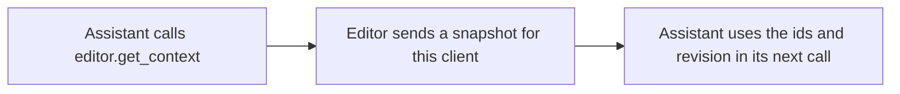

# `editor.get_context`

> Reads the whole scene: every object with its parent and transform, the selection, the revision, and which features the editor supports.

| | |
| --- | --- |
| Provider name | `editor__get_context` |
| Type | Read (permission `read`) |
| Approval | Never |
| Needs the editor | Yes |
| Example | Checked by the backend test on the sample scene |
| Defined in | `apps/backend/src/modules/tools/editor/editor.tools.ts` |
| In the app | Documentation → Assistant tools → Read |

## When the assistant uses it

- First step of any change. It is the only way to learn object ids and the current revision.
- Again when a proposal may have been overtaken by a change.

## Input

No input. Send an empty object.

## Result

| Field | Meaning |
| --- | --- |
| `revision` | The scene revision. Pass it as expectedRevision or sourceRevision. |
| `objects` | id, name, type, parentId, transform, visible, collectionId and worldBounds for each object. |
| `selectedObjectIds` | Objects the user has selected. |
| `designFocus` | Object or Edit mode, and in Edit mode the components the user has picked. |
| `supportsSceneGraph, supportsRepetition, supportsPreparedCommands, supportsCollections` | Which command families this editor accepts. |

## Example

Request:

```json
{}
```

Result:

```json
{
  "projectId": "demo-project",
  "revision": 12,
  "activeSceneName": "Main",
  "selectedObjectIds": [
    "crate"
  ],
  "supportsSceneGraph": true,
  "supportsRepetition": true,
  "supportsPreparedCommands": true,
  "designFocus": {
    "mode": "object",
    "componentKind": null,
    "componentSelection": null
  },
  "objects": [
    {
      "id": "figure",
      "name": "Figure",
      "type": "empty",
      "parentId": null,
      "transform": {
        "position": [
          0,
          0,
          0
        ],
        "rotation": [
          0,
          0,
          0
        ],
        "scale": [
          1,
          1,
          1
        ]
      },
      "visible": true,
      "worldBounds": {
        "min": [
          -1.05,
          0.25,
          -0.3
        ],
        "max": [
          1.05,
          1.8,
          0.3
        ]
      }
    },
    {
      "id": "torso",
      "name": "Torso",
      "type": "mesh",
      "parentId": "figure",
      "transform": {
        "position": [
          0,
          1,
          0
        ],
        "rotation": [
          0,
          0,
          0
        ],
        "scale": [
          1,
          1,
          1
        ]
      },
      "visible": true,
      "worldBounds": {
        "min": [
          -0.5,
          0.25,
          -0.3
        ],
        "max": [
          0.5,
          1.75,
          0.3
        ]
      }
    },
    {
      "id": "arm_left",
      "name": "Arm",
      "type": "mesh",
      "parentId": "figure",
      "transform": {
        "position": [
          -0.9,
          1.2,
          0
        ],
        "rotation": [
          0,
          0,
          0
        ],
        "scale": [
          1,
          1,
          1
        ]
      },
      "visible": true,
      "worldBounds": {
        "min": [
          -1.05,
          0.6,
          -0.15
        ],
        "max": [
          -0.75,
          1.8,
          0.15
        ]
      }
    },
    {
      "id": "arm_right",
      "name": "Arm",
      "type": "mesh",
      "parentId": "figure",
      "transform": {
        "position": [
          0.9,
          1.2,
          0
        ],
        "rotation": [
          0,
          0,
          0
        ],
        "scale": [
          1,
          1,
          1
        ]
      },
      "visible": true,
      "worldBounds": {
        "min": [
          0.75,
          0.6,
          -0.15
        ],
        "max": [
          1.05,
          1.8,
          0.15
        ]
      }
    },
    {
      "id": "crate",
      "name": "Crate",
      "type": "mesh",
      "parentId": null,
      "transform": {
        "position": [
          3,
          0.5,
          0
        ],
        "rotation": [
          0,
          0,
          0
        ],
        "scale": [
          1,
          1,
          1
        ]
      },
      "visible": true,
      "worldBounds": {
        "min": [
          2.5,
          0,
          -0.5
        ],
        "max": [
          3.5,
          1,
          0.5
        ]
      }
    },
    {
      "id": "props",
      "name": "Props",
      "type": "empty",
      "parentId": null,
      "transform": {
        "position": [
          0,
          0,
          0
        ],
        "rotation": [
          0,
          0,
          0
        ],
        "scale": [
          1,
          1,
          1
        ]
      },
      "visible": true,
      "worldBounds": null
    }
  ]
}
```

## How it fits



## Tips

- Use editor.get_scene_summary when only counts are needed; this result can be large. On a large scene read by branch with editor.read_branch, or select with editor.query_objects, and keep this for the exact transforms of objects already chosen.
- worldBounds includes descendants and hidden geometry. It uses geometry bounding boxes, not evaluated shapes.

## Limits

- A snapshot holds up to 2000 objects.
- It does not evaluate geometry. Use editor.measure or editor.inspect_mesh for shape.

## Related

- [`editor.get_scene_summary`](editor.get_scene_summary.md)
- [`editor.read_branch`](editor.read_branch.md)
- [`validation.check_scene`](validation.check_scene.md)
- [`editor.propose_commands`](editor.propose_commands.md)
