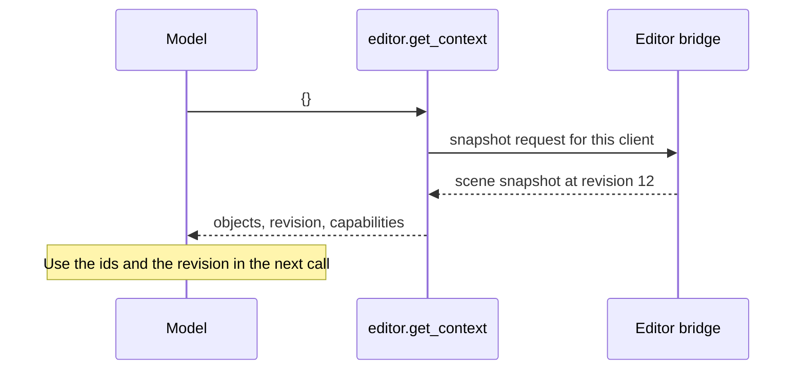

# `editor.get_context`

Reads the whole scene: every object with its parent and transform, the selection, the revision, what the user is doing in the editor, and which features the editor supports.

| | |
| --- | --- |
| Provider name | `editor__get_context` |
| Permission | `read` (never needs approval) |
| Needs the editor | Yes. It asks the connected editor for a snapshot. |
| Defined in | `apps/backend/src/modules/tools/editor/editor.tools.ts` |
| Snapshot schema | `packages/editor-protocol/src/editor-context.schema.ts` |
| Demo | [Read tab](demos/index.html#read) |

## When the assistant uses it

First, before anything else. It is the only way to learn the object ids, the current `revision` and where each object is. The `mesh-editing` skill starts there, and the assistant reads the scene again whenever a proposal may have been overtaken by a change.

## Input

None. The input must be an empty object: `{}` (any extra key is rejected).

## Result

The editor snapshot, as sent by the desktop:

| Field | Meaning |
| --- | --- |
| `revision` | The scene revision. Pass it as `expectedRevision` or as `sourceRevision` to the calculated tools. |
| `projectId`, `activeSceneName` | Which project and scene are open. |
| `selectedObjectIds` | Objects the user has selected. |
| `objects` | Each object's `id`, `name`, `type` (`mesh`, `empty`, `collection`, `camera`, `light`), `parentId`, `transform` (position, rotation, scale), `visible`, `collectionId` and `worldBounds`. |
| `designFocus` | Object or Edit mode, and in Edit mode the components the user has picked. |
| `collections` | Named groups of objects, when the editor has them. |
| `meshInspection`, `measurement` | Present only when a request asked for them. |
| `supportsSceneGraph`, `supportsRepetition`, `supportsPreparedCommands`, `supportsCollections` | Which command families this editor accepts. |

## Example

Request:

```json
{}
```

Result (shortened; the demo page shows the full snapshot):

```json
{
  "projectId": "demo-project",
  "revision": 12,
  "activeSceneName": "Main",
  "selectedObjectIds": ["crate"],
  "supportsSceneGraph": true,
  "supportsRepetition": true,
  "supportsPreparedCommands": true,
  "designFocus": { "mode": "object", "componentKind": null, "componentSelection": null },
  "objects": [
    { "id": "figure", "name": "Figure", "type": "empty", "parentId": null, "transform": { "position": [0, 0, 0], "rotation": [0, 0, 0], "scale": [1, 1, 1] }, "visible": true, "worldBounds": { "min": [-1.05, 0.25, -0.3], "max": [1.05, 1.8, 0.3] } },
    { "id": "torso", "name": "Torso", "type": "mesh", "parentId": "figure", "...": "..." },
    { "id": "crate", "name": "Crate", "type": "mesh", "parentId": null, "transform": { "position": [3, 0.5, 0], "rotation": [0, 0, 0], "scale": [1, 1, 1] }, "visible": true, "worldBounds": { "min": [2.5, 0, -0.5], "max": [3.5, 1, 0.5] } }
  ]
}
```

## Visual example

The same scene as a tree. Indentation is the parent relation; the bounds are world space.

```text
Figure      empty  [-1.05, 0.25, -0.3] to [1.05, 1.8, 0.3]
├── Torso   mesh   [-0.5, 0.25, -0.3]  to [0.5, 1.75, 0.3]
├── Arm     mesh   [-1.05, 0.6, -0.15] to [-0.75, 1.8, 0.15]
└── Arm     mesh   [0.75, 0.6, -0.15]  to [1.05, 1.8, 0.15]
Crate       mesh   [2.5, 0, -0.5]      to [3.5, 1, 0.5]      <- selected
Props       empty  (no geometry)
```

## How it fits



## Limits and errors

- If no editor is connected for this run, the tool returns an error to the model, and the model cannot read the scene.
- Its result can be large for a big scene (up to 2000 objects). Use `editor.get_scene_summary` for counts only.
- It does not evaluate geometry. Use `editor.measure` or `editor.inspect_mesh` for shape.

## Related

- [`editor.get_scene_summary`](editor.get_scene_summary.md) for counts.
- [`validation.check_scene`](validation.check_scene.md) to find problems in the same snapshot.
- [`editor.propose_commands`](editor.propose_commands.md), which takes the `revision` read here.
