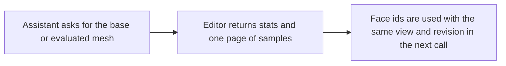

# `editor.inspect_mesh`

> Reads the topology of one mesh: vertices, edges and faces, the faces that match a direction or position query, and its bounds.

| | |
| --- | --- |
| Provider name | `editor__inspect_mesh` |
| Type | Read (permission `read`) |
| Approval | Never |
| Needs the editor | Yes |
| Example | Live editor output; the test checks its shape |
| Defined in | `apps/backend/src/modules/tools/editor/editor.tools.ts` |
| In the app | Documentation → Assistant tools → Read |

## When the assistant uses it

- Before any geometry change, so the change uses real ids.
- To answer questions such as which faces point up, or whether a mesh is closed.

## Input

The request is validated by meshInspectionRequestSchema.

| Name | Type | Required | Default | Meaning |
| --- | --- | --- | --- | --- |
| `objectId` | identifier | Yes | – | The object to inspect. |
| `meshPath` | mesh path | No | `[]` | A mesh inside the object. [] is the object itself. |
| `view` | base \| evaluated | No | `evaluated` | base reads the unmodified cage that edits change; evaluated reads the displayed mesh. |
| `offset` | integer 0–100000 | No | `0` | Page offset for the vertex, edge and face samples. |
| `limit` | integer 1–100 | No | `25` | Samples per page. |
| `includeSamples` | boolean | No | – | false omits the vertex, edge and face pages. |
| `materialsOnly` | boolean | No | – | true reads materials without topology. |
| `faceQuery` | object | No | – | Filters faces. Needs normal, or a centerMin/centerMax bound. |

## faceQuery fields

| Item | Meaning |
| --- | --- |
| `normal` | A nonzero direction in mesh-local space. |
| `minDot` | How closely a face must point along normal, from -1 to 1. The description's default is 0.9. |
| `centerMin, centerMax` | Local bounds that a face's centre must lie inside. |
| `offset, limit` | Paging for matches. limit is 1–1000, default 100. |

## Result

| Field | Meaning |
| --- | --- |
| `revision, message` | The scene revision, and why the inspection is unavailable when it is. |
| `inspection.status` | ok, unsupported or not_found. |
| `inspection.stats` | vertices (welded), renderVertices, edges, faces (polygons), triangles, boundaryEdges, nonManifoldEdges, inconsistentEdges, materialSlots. |
| `localBounds, matrixWorld` | Bounds in mesh space, and the matrix that places the mesh in the scene. |
| `vertices, edges, faces` | One page of samples. Indices refer to the whole mesh, not to the page. |
| `faceMatches` | ids of matching faces on this page, with total, offset and hasMore. |

## Example

Request:

```json
{
  "objectId": "crate",
  "view": "evaluated",
  "limit": 25,
  "faceQuery": {
    "normal": [
      0,
      1,
      0
    ],
    "minDot": 0.95,
    "limit": 100
  }
}
```

Result:

```json
{
  "revision": 12,
  "message": null,
  "inspection": {
    "objectId": "crate",
    "meshPath": [],
    "view": "evaluated",
    "status": "ok",
    "parts": [],
    "partsTruncated": false,
    "stats": {
      "renderVertices": 24,
      "vertices": 8,
      "edges": 12,
      "faces": 6,
      "triangles": 12,
      "boundaryEdges": 0,
      "nonManifoldEdges": 0,
      "inconsistentEdges": 0,
      "attributes": [
        "normal",
        "position",
        "uv"
      ],
      "materialGroups": 1,
      "materialSlots": 1
    },
    "offset": 0,
    "baseTriangles": 12,
    "skinned": false,
    "localBounds": {
      "min": [
        -0.5,
        -0.5,
        -0.5
      ],
      "max": [
        0.5,
        0.5,
        0.5
      ]
    },
    "matrixWorld": [
      1,
      0,
      0,
      0,
      0,
      1,
      0,
      0,
      0,
      0,
      1,
      0,
      3,
      0.5,
      0,
      1
    ],
    "faceMatches": {
      "ids": [
        "5"
      ],
      "total": 1,
      "offset": 0,
      "hasMore": false
    },
    "edges": [
      {
        "vertices": [
          0,
          1
        ],
        "faces": [
          0,
          4
        ]
      },
      {
        "vertices": [
          0,
          3
        ],
        "faces": [
          0,
          2
        ]
      },
      {
        "vertices": [
          1,
          2
        ],
        "faces": [
          0,
          3
        ]
      },
      {
        "vertices": [
          2,
          3
        ],
        "faces": [
          0,
          5
        ]
      },
      {
        "vertices": [
          0,
          4
        ],
        "faces": [
          2,
          4
        ]
      },
      {
        "vertices": [
          3,
          7
        ],
        "faces": [
          2,
          5
        ]
      },
      {
        "vertices": [
          1,
          5
        ],
        "faces": [
          3,
          4
        ]
      },
      {
        "vertices": [
          2,
          6
        ],
        "faces": [
          3,
          5
        ]
      },
      {
        "vertices": [
          4,
          5
        ],
        "faces": [
          1,
          4
        ]
      },
      {
        "vertices": [
          5,
          6
        ],
        "faces": [
          1,
          3
        ]
      },
      {
        "vertices": [
          4,
          7
        ],
        "faces": [
          1,
          2
        ]
      },
      {
        "vertices": [
          6,
          7
        ],
        "faces": [
          1,
          5
        ]
      }
    ],
    "vertices": [
      {
        "index": 0,
        "position": [
          -0.5,
          -0.5,
          -0.5
        ]
      },
      {
        "index": 1,
        "position": [
          0.5,
          -0.5,
          -0.5
        ]
      },
      {
        "index": 2,
        "position": [
          0.5,
          0.5,
          -0.5
        ]
      },
      {
        "index": 3,
        "position": [
          -0.5,
          0.5,
          -0.5
        ]
      },
      {
        "index": 4,
        "position": [
          -0.5,
          -0.5,
          0.5
        ]
      },
      {
        "index": 5,
        "position": [
          0.5,
          -0.5,
          0.5
        ]
      },
      {
        "index": 6,
        "position": [
          0.5,
          0.5,
          0.5
        ]
      },
      {
        "index": 7,
        "position": [
          -0.5,
          0.5,
          0.5
        ]
      }
    ],
    "faces": [
      {
        "index": 0,
        "vertices": [
          0,
          3,
          2,
          1
        ]
      },
      {
        "index": 1,
        "vertices": [
          4,
          5,
          6,
          7
        ]
      },
      {
        "index": 2,
        "vertices": [
          0,
          4,
          7,
          3
        ]
      },
      {
        "index": 3,
        "vertices": [
          1,
          2,
          6,
          5
        ]
      },
      {
        "index": 4,
        "vertices": [
          0,
          1,
          5,
          4
        ]
      },
      {
        "index": 5,
        "vertices": [
          3,
          7,
          6,
          2
        ]
      }
    ]
  }
}
```

## How it fits



## Tips

- Inspect the base view before editing: geometry edits change the base cage.
- faceMatches holds ids, not positions. Read hasMore before relying on a page.

## Limits

- Meshes above about 20,000 triangles may be unsupported.
- Inspection reports geometry counts. It does not judge appearance; use viewport.capture for that.

## Related

- [`editor.inspect_materials`](editor.inspect_materials.md)
- [`modeling.generate_commands`](modeling.generate_commands.md)
- [`editor.propose_commands`](editor.propose_commands.md)
