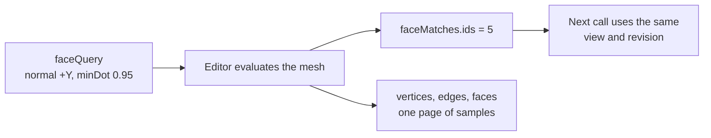

# `editor.inspect_mesh`

Reads the topology of one mesh: its vertices, edges and faces, the faces that match a direction or position query, and its bounds. It is how the assistant sees geometry rather than only object positions.

| | |
| --- | --- |
| Provider name | `editor__inspect_mesh` |
| Permission | `read` (never needs approval). Nothing changes. |
| Needs the editor | Yes. The editor evaluates the mesh and sends the result. |
| Defined in | `apps/backend/src/modules/tools/editor/editor.tools.ts` |
| Schema | `meshInspectionRequestSchema` in `packages/editor-protocol/src/mesh.schema.ts` |
| Demo | [Read tab](demos/index.html#read) |

## When the assistant uses it

Before any geometry change, so the change uses real ids. It also answers questions such as "which faces point up?" and "is this mesh closed?". The assistant is told to inspect the mesh before it modifies geometry, and the `mesh-editing` skill lists it among its tools.

## Input

| Field | Type | Required | Default | Meaning |
| --- | --- | --- | --- | --- |
| `objectId` | identifier | yes | | The object to inspect. |
| `meshPath` | mesh path | no | `[]` | A mesh inside the object. `[]` is the object itself. |
| `view` | `base` or `evaluated` | no | `evaluated` | `base` reads the unmodified cage; `evaluated` reads the displayed mesh. |
| `offset` | integer 0–100000 | no | `0` | Page offset for the vertex, edge and face samples. |
| `limit` | integer 1–100 | no | `25` | Samples per page. |
| `includeSamples` | boolean | no | | Set `false` to omit the vertex, edge and face pages. |
| `materialsOnly` | boolean | no | | Set `true` to read materials without topology. |
| `faceQuery` | object | no | | Filters faces. It must include `normal` or a `centerMin`/`centerMax` bound. |

`faceQuery` fields: `normal` (a nonzero direction in mesh-local space), `minDot` (−1 to 1, default `0.9` in the description), `centerMin` and `centerMax` (local bounds of a face's center), `offset`, and `limit` (1–1000, default 100) for the matches.

## Result

```text
{ revision, message, inspection }
```

`inspection` (when the mesh can be read):

| Field | Meaning |
| --- | --- |
| `status` | `ok`, `unsupported` or `not_found`. |
| `stats` | Counts: `vertices` (welded), `renderVertices`, `edges`, `faces` (polygons), `triangles`, `boundaryEdges`, `nonManifoldEdges`, `inconsistentEdges`, `attributes`, `materialGroups`, `materialSlots`. |
| `localBounds`, `matrixWorld` | Bounds in mesh space and the matrix that places the mesh in the scene. |
| `vertices`, `edges`, `faces` | The samples for this page. Indices refer to the whole mesh, not to the page. |
| `faceMatches` | `ids` of the faces that match `faceQuery` on this page, plus `total`, `offset` and `hasMore`. |
| `parts`, `partsTruncated` | The mesh paths inside an imported model. |

## Example

Request (find the faces that point up in the crate's own space):

```json
{
  "objectId": "crate",
  "view": "evaluated",
  "limit": 25,
  "faceQuery": { "normal": [0, 1, 0], "minDot": 0.95, "limit": 100 }
}
```

Result (shortened; the demo page shows all 8 vertices, 12 edges and 6 faces):

```json
{
  "revision": 12,
  "message": null,
  "inspection": {
    "objectId": "crate", "meshPath": [], "view": "evaluated", "status": "ok",
    "stats": { "renderVertices": 24, "vertices": 8, "edges": 12, "faces": 6, "triangles": 12, "boundaryEdges": 0, "nonManifoldEdges": 0, "inconsistentEdges": 0, "attributes": ["normal", "position", "uv"], "materialGroups": 1, "materialSlots": 1 },
    "localBounds": { "min": [-0.5, -0.5, -0.5], "max": [0.5, 0.5, 0.5] },
    "matrixWorld": [1, 0, 0, 0, 0, 1, 0, 0, 0, 0, 1, 0, 3, 0.5, 0, 1],
    "faceMatches": { "ids": ["5"], "total": 1, "offset": 0, "hasMore": false },
    "vertices": [{ "index": 0, "position": [-0.5, -0.5, -0.5] }, "…"],
    "faces": [{ "index": 0, "vertices": [0, 3, 2, 1] }, "…", { "index": 5, "vertices": [3, 7, 6, 2] }]
  }
}
```

## Visual example

Faces of the crate in its local space. Face 5 is the top, and it is the only face that matches the query.

```text
Vertices (local)            Faces (vertex order)           Match
v3 (-.5,+.5,-.5)  v2 (+.5,+.5,-.5)   0 back    [0 3 2 1]
v7 (-.5,+.5,+.5)  v6 (+.5,+.5,+.5)   1 front   [4 5 6 7]
v0 (-.5,-.5,-.5)  v1 (+.5,-.5,-.5)   2 left    [0 4 7 3]
v4 (-.5,-.5,+.5)  v5 (+.5,-.5,+.5)   3 right   [1 2 6 5]
                                     4 bottom  [0 1 5 4]
                                     5 top     [3 7 6 2]   <== normal +Y, dot 1.0
```

The demo page draws the same cube in isometric view with face 5 highlighted.

## How it fits



Ids are only meaningful with the `view` and `revision` they came from. `view: base` is the cage that edits change; `evaluated` is the displayed result after modifiers.

## Limits and errors

- Meshes above about 20,000 triangles may be `unsupported`. The message says so.
- A `not_found` status means the object or mesh path does not exist. Inspect again from the object to get current paths.
- `faceQuery` pages are capped at 1000 matches each. Read `hasMore` before assuming a list is complete.
- Inspection is geometric: it reports boundary, non-manifold and winding counts, not whether the shape looks right. Use [`viewport.capture`](viewport.capture.md) for that.
- Omit `includeSamples` (or set it `false`) to read IDs only, which is cheaper for large meshes.

## Related

- [`editor.inspect_materials`](editor.inspect_materials.md) for slot and material detail without topology.
- [`modeling.generate_commands`](modeling.generate_commands.md), which takes an inspection to build edits programmatically.
- [`editor.propose_commands`](editor.propose_commands.md), which takes the base `revision` read here.
