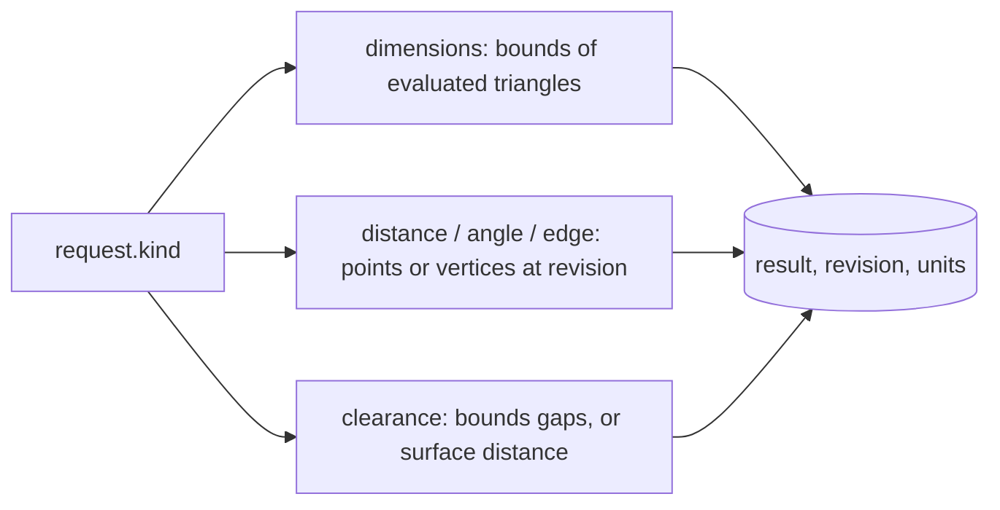

# `editor.measure`

Measures the geometry the editor is showing: the size of an object, the distance between two points, an angle, an edge length, or the clearance between two objects. Results are computed from evaluated geometry, so modifiers and Booleans are included.

| | |
| --- | --- |
| Provider name | `editor__measure` |
| Permission | `read` (never needs approval) |
| Needs the editor | Yes. The editor computes the measurement. |
| Defined in | `apps/backend/src/modules/tools/editor/editor.tools.ts` |
| Schema | `measurementRequestSchema` in `packages/editor-protocol/src/measurement.schema.ts` |
| Demo | [Read tab](demos/index.html#read) |

## When the assistant uses it

When the user asks how big something is, how far apart two things are, or whether two objects touch. It also supplies the `revision` that placement and proposals depend on, and it is the check after a placement is applied.

## Input

```json
{ "request": { "kind": "...", "...": "..." } }
```

`request.kind` selects one of five measurements:

| `kind` | Fields | Returns |
| --- | --- | --- |
| `dimensions` | `target` (`{ objectId, meshPath?, descendants? }`), `space` (`world` default, or `local`) | `bounds`, `size`, `center`, `parentWorldInverse` |
| `distance` | `from`, `to`: each a point `[x, y, z]`, or `{ objectId, meshPath?, vertex, view?, revision }` | `from`, `to`, `delta`, `length` |
| `edge` | `objectId`, `meshPath?`, `view?`, `revision`, `edge` (`a_b`, the canonical edge id) | endpoints, `delta`, `length` |
| `angle` | `from`, `at`, `to`: points or vertex references | `degrees` at the middle point |
| `clearance` | `first`, `second` (targets), `method`: `bounds` (default) or `surface` | `distance`, both bounds, `axisGap` |

`bounds` clearance gives the gap on each axis and its Euclidean length. It is not a collision test. `surface` clearance measures the closest boundary-surface distance and gives zero when the surfaces intersect.

## Result

```text
{ revision, units, result }
```

- `units` is `null` for an uncalibrated project, or `{ display, metersPerSceneUnit }`.
- `result` is `{ status: "ok", data }`, or `{ status: "unavailable", message }` that says why (stale ids, empty geometry, unsupported geometry or a limit that was exceeded).

## Example

Request: the clear gap between the torso and the crate.

```json
{ "request": { "kind": "clearance", "first": { "objectId": "torso" }, "second": { "objectId": "crate" }, "method": "bounds" } }
```

Result:

```json
{
  "revision": 12,
  "units": null,
  "result": {
    "status": "ok",
    "data": {
      "kind": "clearance", "method": "bounds", "distance": 2,
      "firstBounds": { "min": [-0.5, 0.25, -0.3], "max": [0.5, 1.75, 0.3] },
      "secondBounds": { "min": [2.5, 0, -0.5], "max": [3.5, 1, 0.5] },
      "axisGap": [2, 0, 0],
      "secondParentWorldInverse": [1, 0, 0, 0, 0, 1, 0, 0, 0, 0, 1, 0, 0, 0, 0, 1]
    }
  }
}
```

## Visual example

Top view. The torso's right face is at x 0.5, the crate's left face is at x 2.5, so the gap is 2.

```text
x:   -1.0   -0.5    0.0    0.5    1.5    2.5    3.5
            +-------+                  +-------+
            | Torso |<---- gap 2 ---->| Crate |
            +-------+                  +-------+
(z across the middle is 0; the torso is 0.6 deep, the crate 1.0)
```

## How it fits



Vertex and edge references are tied to a revision. If the scene has changed since it was read, the result is `unavailable` with an explanation, and the assistant should read the scene again.

## Limits and errors

- Surface clearance is limited to 20,000 triangles per target and a bounded amount of work. Beyond that it reports `unavailable`.
- Dimensions include descendants and hidden geometry by default.
- Instanced or deformed geometry (skins, morph targets) cannot use component references; use a bounds measurement instead.
- Lengths are in scene units unless the project has a calibration, in which case `units` says how many meters one scene unit is.

## Related

- [`editor.plan_placement`](editor.plan_placement.md), which uses the same bounds to place objects.
- [`editor.inspect_mesh`](editor.inspect_mesh.md) for the vertex and edge ids that distance and edge measurements use.
