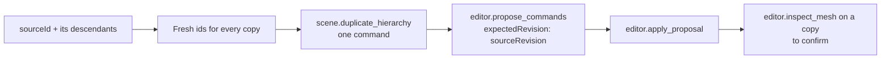

# `editor.plan_duplicates`

Plans independent copies of an object and everything under it. Each copy gets fresh ids, its own geometry and materials, and a position offset from the source. It returns one `scene.duplicate_hierarchy` command and changes nothing until that command is proposed and applied.

| | |
| --- | --- |
| Provider name | `editor__plan_duplicates` |
| Permission | `read` (never needs approval). Nothing changes. |
| Needs the editor | Yes. It needs an editor that supports repetition (`supportsRepetition`). |
| Defined in | `apps/backend/src/modules/tools/editor/duplication.tools.ts` |
| Demo | [Calculate section of the Read tab](demos/index.html#read) |

## When the assistant uses it

To make a row, a grid or a stack of copies of a finished part: "make three more chairs", "a row of five posts". For a row of simple shapes made from scratch, [`modeling.generate_commands`](modeling.generate_commands.md) is an alternative.

## Input

| Field | Type | Required | Meaning |
| --- | --- | --- | --- |
| `sourceId` | identifier | yes | The object to copy. Its descendants are copied with it. |
| `copies` | integer 1–63 | yes | Additional copies. |
| `offset` | `[x, y, z]` | yes | Finite, within ±100000 per axis. Each copy moves by `offset × its number`, so copy 1 moves once, copy 2 twice. |
| `space` | `parent` (default) or `world` | no | Whether the offset is in the parent's axes or in world axes. |
| `name` | string, 1–80 characters | no | A label for the copies' roots. Names are numbered among siblings when applied. |

## Result

```text
{ sourceRevision, commands, nextAction }
```

`commands` holds one `scene.duplicate_hierarchy` command. Its `copies` list gives each root a new `objectId`, and each registered descendant a new `objectId` paired with its `sourceId`.

## Example

Request: two copies of the figure, spaced 2.5 units apart along x in world space.

```json
{ "sourceId": "figure", "copies": 2, "offset": [2.5, 0, 0], "space": "world", "name": "Figure copy" }
```

Result (ids shortened):

```json
{
  "sourceRevision": 12,
  "commands": [
    {
      "commandId": "duplicate", "type": "scene.duplicate_hierarchy", "sourceId": "figure", "offset": [2.5, 0, 0], "space": "world",
      "copies": [
        {
          "objectId": "obj_9a1e6c2f-3b7d-4e5a-8c9f-1d2e3f4a5b60", "name": "Figure copy",
          "descendants": [
            { "sourceId": "torso", "objectId": "obj_0f7c4d2a-6e1b-4a9d-b3c8-5e2f1a7d9c10" },
            { "sourceId": "arm_left", "objectId": "obj_2b8e5a13-9d4f-4c6e-a1b7-7f3e0c2d8a21" },
            { "sourceId": "arm_right", "objectId": "obj_c4d19e7f-1a2b-4f3c-8d5e-6a9b0c1e2f32" }
          ]
        },
        { "objectId": "obj_e83a6b05-4c2d-4e1f-9b7a-3d8c5f6e0a43", "name": "Figure copy", "descendants": ["…the same three, with new ids"] }
      ]
    }
  ],
  "nextAction": "Propose these commands with expectedRevision: sourceRevision, then apply and inspect the copies."
}
```

## Visual example

Top view. The source and two copies, each moved one more step of 2.5 along x.

```text
x:  -1.0      0.0      1.0      2.0      3.0      4.0      5.0      6.0
    +-------------+
    |   Figure    |   +-------------+
    +-------------+   |   copy 1    |   +-------------+
                      +-------------+   |   copy 2    |
                                        +-------------+
```

## How it fits



Each copy has its own geometry, material instances and skeleton. Texture images are shared. Internal Boolean operands are remapped to the copy; an external cutter stays linked to the original, and the result is recalculated.

## Limits and errors

- The editor must report `supportsRepetition`. Older editors fail with "Update the editor for hierarchy duplication".
- The source must exist. Otherwise the call fails with "Source object does not exist".
- Copies plus the existing objects may not exceed 2000 objects. The geometry budget is 128 MiB.
- A skinned hierarchy must include all of its bones, or the copy is rejected.
- Ids are fresh on every call, so the same plan produces different ids each time. Refer to copies by name after it is applied.

## Related

- [`editor.propose_commands`](editor.propose_commands.md) and [`editor.apply_proposal`](editor.apply_proposal.md), which carry the command.
- [`editor.plan_placement`](editor.plan_placement.md) to move copies into a line afterwards.
- [`modeling.generate_commands`](modeling.generate_commands.md) for repeats of new shapes rather than copies.
