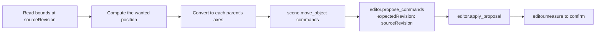

# `editor.plan_placement`

Works out the moves that line objects up, space them out or snap them to a point, using the world bounds of the evaluated geometry. It returns `scene.move_object` commands and changes nothing. The commands must still be proposed and applied.

| | |
| --- | --- |
| Provider name | `editor__plan_placement` |
| Permission | `read` (never needs approval). Nothing changes. |
| Needs the editor | Yes, to read the bounds |
| Defined in | `apps/backend/src/modules/tools/editor/placement.tools.ts` |
| Demo | [Calculate section of the Read tab](demos/index.html#read) |

## When the assistant uses it

When a placement should be exact: "put the crate on the floor", "a gap of 20 mm to the left", "space these four posts evenly". Typing coordinates by hand misses bounds and parents; this tool does not.

## Input

`{ "request": ... }`, where `request.kind` is one of four operations:

| `kind` | Fields | What it does |
| --- | --- | --- |
| `align` | `objectIds` (1–50), `referenceId`, `axes` (`x`, `y`, `z`, unique), `sourceAnchor` and `referenceAnchor` (`min`, `center` or `max`; default `center`) | Moves the objects so one bound or centre matches the reference's, on each chosen axis. |
| `gap` | `objectIds`, `referenceId`, `axis`, `side` (`positive` default or `negative`), `gap` (signed), `unit` (`scene` default, or `mm`, `cm`, `m`, `in`, `ft`) | Places each object's nearest face at the gap from the reference. Physical units need a calibrated project. |
| `distribute` | `objectIds` (at least 3, in increasing order on the axis), `axis`, `mode` (`gaps` default, or `centers`) | Keeps the first and last objects fixed and spaces the rest evenly. |
| `snap` | `objectIds` (exactly one), `from` and `to` (world points), `expectedRevision` | Moves the object so `from` lands on `to`. |

Objects must be separate from the reference, and an object cannot be both an ancestor and a descendant of another target.

## Result

```text
{ sourceRevision, commands, status, nextAction }
```

- `commands`: `scene.move_object` commands, each with a `delta` along the parent's axes. Empty when nothing needs to move.
- `status`: `planned`, or `already_placed` when the commands would be empty.
- `sourceRevision`: propose the commands with this as `expectedRevision`.

## Example

Request: align the bottom of the crate with the bottom of the torso. The crate's bottom is at y 0 and the torso's is at y 0.25.

```json
{ "request": { "kind": "align", "objectIds": ["crate"], "referenceId": "torso", "axes": ["y"], "sourceAnchor": "min", "referenceAnchor": "min" } }
```

Result:

```json
{
  "sourceRevision": 12,
  "commands": [{ "commandId": "placement_0", "type": "scene.move_object", "objectId": "crate", "delta": [0, 0.25, 0] }],
  "status": "planned",
  "nextAction": "Propose commands with expectedRevision: sourceRevision, then apply. Re-measure the result."
}
```

## Visual example

Side view. The crate rises 0.25 so its bottom matches the torso's bottom.

```text
y
1.75 +-------+                     Torso (x -0.5..0.5, y 0.25..1.75)
     |       |
0.25 +-------+ - - - - - - - - - - - - - - - - - - - - - -  bottoms aligned at y 0.25
1.25                         +-------+
     [ torso ]               | crate | planned (moved +0.25 on y)
1.00                         :       :
     ...                     : crate : now (x 2.5..3.5, y 0..1)
0.00 ----------------------- +-------+ ----------------------------------- ground
```

## How it fits



Commands are returned in each object's parent space, so an object inside a group moves correctly. The tool does not check whether the moved shapes collide after a Boolean changes them; measure again afterwards.

## Limits and errors

- A missing object, duplicate references, ancestors and descendants in the same plan, a cycle, or a singular (zero-scale) parent is an error with a message.
- `snap` fails with "Scene changed; inspect the points again" when `expectedRevision` is not the current revision.
- Physical units without calibration fail with "Calibrate project units before physical placement".
- Bounds placement does not guarantee contact or the absence of collisions, particularly when Booleans change shapes.
- Distribute fails when the endpoints leave too little room for non-overlapping gaps.

## Related

- [`editor.measure`](editor.measure.md), which confirms the result after it is applied.
- [`editor.plan_duplicates`](editor.plan_duplicates.md) for copies rather than moves.
- [`editor.propose_commands`](editor.propose_commands.md) and [`editor.apply_proposal`](editor.apply_proposal.md).
