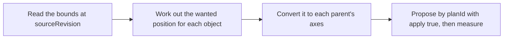

# `editor.plan_placement`

> Works out the moves that align, space or snap objects, using the world bounds of evaluated geometry. It returns scene.move_object commands and changes nothing.

| | |
| --- | --- |
| Provider name | `editor__plan_placement` |
| Type | Read (permission `read`) |
| Approval | Never |
| Needs the editor | Yes |
| Example | Checked by the backend test on the sample scene |
| Defined in | `apps/backend/src/modules/tools/editor/placement.tools.ts` |
| In the app | Documentation → Assistant tools → Read |

## When the assistant uses it

- When a placement must be exact: put the crate on the floor, leave a 20 mm gap, space four posts evenly.
- Typing coordinates by hand misses bounds and parents. This tool does not.

## Input

| Name | Type | Required | Default | Meaning |
| --- | --- | --- | --- | --- |
| `request` | placement request | Yes | – | One of four operations, selected by request.kind (see the table). |

## Placement operations

| Item | Meaning |
| --- | --- |
| `align` | objectIds (1–50), referenceId, axes (x, y, z), sourceAnchor and referenceAnchor (min, center or max). Matches bounds or centres. |
| `gap` | objectIds, referenceId, axis, side (positive or negative), a signed gap, and unit (scene, mm, cm, m, in or ft). Physical units need calibration. |
| `distribute` | At least three objectIds in increasing order on one axis. The endpoints stay put; mode gaps or centers spaces the rest. |
| `snap` | Exactly one object, world points from and to, and expectedRevision. Moves from onto to. |

## Result

| Field | Meaning |
| --- | --- |
| `sourceRevision` | Propose the commands with this as expectedRevision. |
| `commands` | scene.move_object commands, each with a delta in the parent's axes. Empty when nothing needs to move. |
| `status` | planned, or already_placed. |
| `planId` | Pass it to editor.propose_commands instead of the commands. Left out when nothing needs to move. |
| `nextAction` | The next step: propose by planId with apply true, then measure again. |

## Example

Request:

```json
{
  "request": {
    "kind": "align",
    "objectIds": [
      "crate"
    ],
    "referenceId": "torso",
    "axes": [
      "y"
    ],
    "sourceAnchor": "min",
    "referenceAnchor": "min"
  }
}
```

Result:

```json
{
  "sourceRevision": 12,
  "planId": "batch_1",
  "commands": [
    {
      "commandId": "placement_0",
      "type": "scene.move_object",
      "objectId": "crate",
      "delta": [
        0,
        0.25,
        0
      ]
    }
  ],
  "status": "planned",
  "nextAction": "Call editor.propose_commands with this planId and apply true, then re-measure the result."
}
```

## How it fits



## Tips

- Use align with min anchors to put objects on a shared floor.
- Bounds placement does not guarantee contact or the absence of collisions. Measure again afterwards.

## Limits

- A physical gap needs a calibrated project.
- Distribute fails when the endpoints leave too little room for non-overlapping gaps.

## Errors you may see

| Message | Cause |
| --- | --- |
| `Scene changed; inspect the points again` | snap was planned against an older expectedRevision. |
| `Calibrate project units before physical placement` | A gap used mm, cm, m, in or ft without a calibration. |
| `Placement targets cannot contain ancestors and descendants` | A moving object and the reference are in one branch of the hierarchy. |

## Related

- [`editor.measure`](editor.measure.md)
- [`editor.plan_duplicates`](editor.plan_duplicates.md)
- [`editor.propose_commands`](editor.propose_commands.md)
