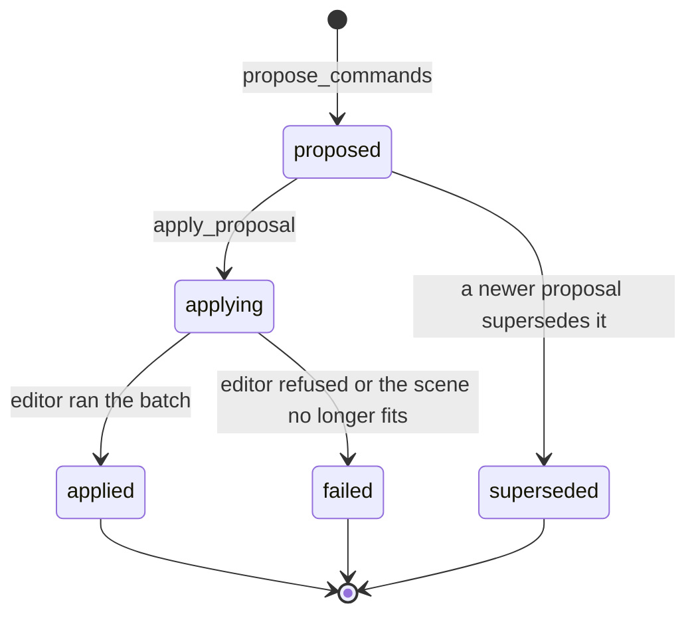

# `editor.propose_commands`

Stores a batch of scene commands for review. The batch is checked against the scene, given an id, and kept waiting. Nothing changes until `editor.apply_proposal` is called with that id.

| | |
| --- | --- |
| Provider name | `editor__propose_commands` |
| Permission | `propose` (never needs approval). It stores; it does not apply. |
| Needs the editor | Yes, to check the batch against the current scene |
| Defined in | `apps/backend/src/modules/tools/editor/editor.tools.ts` |
| Command schema | `editorCommandListSchema` in `packages/editor-protocol/src/editor-command.schema.ts` |
| Demo | [Propose tab](demos/index.html#propose) |

## When the assistant uses it

For every change to the scene. The assistant reads the scene, calculates or writes the commands, proposes them, and then applies the proposal. A proposal is also how the assistant changes a waiting proposal: it sends a new batch with `supersedes`.

## Input

| Field | Type | Required | Meaning |
| --- | --- | --- | --- |
| `summary` | string, 1–300 characters | yes | What the batch does, in words the user will read. |
| `commands` | 1–200 commands | yes | Run in order. A later command may use an object an earlier one created. |
| `expectedRevision` | integer ≥ 0 | no | The revision the batch was written for. It makes the proposal *strict*. |
| `supersedes` | identifier | no | A waiting proposal from this run that this one replaces. |
| `stepId` | identifier | no | A step of the latest plan that this batch carries out. |

Commands are listed in the [assistant tools inventory](../assistant-tools.md#editor-commands). The common ones are `scene.move_object` (move by a delta), `scene.transform_object` (set a position, rotation or scale), `scene.rename_object`, `scene.set_visibility`, `scene.set_parent`, `scene.delete_object`, `geometry.create_primitive` and `geometry.create_mesh`.

## Result

On success:

```json
{
  "proposalId": "prp_7e2b9c4d1a6f4b08",
  "status": "proposed",
  "requiresApproval": false,
  "commandCount": 2,
  "baseRevision": 12,
  "supersedes": null,
  "planStep": null,
  "nextAction": "Call editor.apply_proposal with this proposalId to apply automatically."
}
```

- `status` is `proposed`. It can also be `superseded` later, or `applied`, `failed` or `rejected` once acted on.
- `requiresApproval` is always `false` for assistant proposals.
- With a `stepId` that is not in the latest plan, the result is `{ "status": "rejected", "reason": "...", "availableStepIds": [...] }` and nothing is stored.

If a command does not fit the scene, the call fails with the list of problems, each with its `commandId` and how to fix it. The model corrects the batch and proposes again.

## Example

Request:

```json
{
  "summary": "Raise the crate 2 units and rename it",
  "expectedRevision": 12,
  "commands": [
    { "commandId": "raise", "type": "scene.move_object", "objectId": "crate", "delta": [0, 2, 0] },
    { "commandId": "rename", "type": "scene.rename_object", "objectId": "crate", "name": "Supply crate" }
  ]
}
```

Result: the JSON above, with `commandCount: 2`.

## Visual example

```text
PROPOSAL prp_7e2b9c4d1a6f4b08   revision 12   2 commands   no approval prompt

  1  raise   scene.move_object    crate   by [0, 2, 0]
  2  rename  scene.rename_object  crate   to "Supply crate"

  [ proposed ] ──► [ applying ] ──► [ applied ]
       ▲ you are here          next: editor.apply_proposal
```

## How it fits



A `proposed` batch is stored in the backend with the revision it was written for, and only then is the editor told about it.

## Limits and errors

- At most 200 commands per proposal.
- Command validation runs now and again on apply. A command that refers to an object that does not exist is an error, with its `commandId`.
- `expectedRevision` makes the proposal strict. If the scene changes before it is applied, it fails and must be regenerated. Without it, the batch is re-checked on the new scene and may be applied with `rebased: true`.
- Batches with geometry edits, material edits or hierarchy copies are always strict.
- Collections, scene-graph features and some modifier operations need an editor that supports them. The check says so when they are missing.

## Related

- [`editor.apply_proposal`](editor.apply_proposal.md), which applies the proposal.
- [`modeling.propose_generated`](modeling.propose_generated.md) makes a proposal from a program, without echoing the commands.
- [`viewport.capture`](viewport.capture.md) with `proposalId` to see the proposal before applying it.
