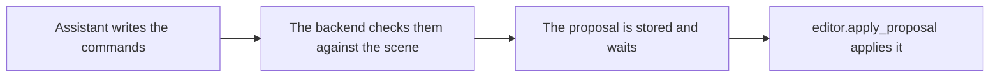

# `editor.propose_commands`

> Checks a batch of scene commands against the scene and stores it. With apply true it also applies the batch in the same call, the usual way to make a change; without it the batch waits for editor.apply_proposal.

| | |
| --- | --- |
| Provider name | `editor__propose_commands` |
| Type | Propose (permission `propose`) |
| Approval | Never |
| Needs the editor | Yes |
| Example | Checked by the backend test on the sample scene |
| Defined in | `apps/backend/src/modules/tools/editor/editor.tools.ts` |
| In the app | Documentation → Assistant tools → Propose |

## When the assistant uses it

- For every change to the scene: read, calculate, then propose with apply true.
- Without apply, when the proposal should be looked at with viewport.capture before it is applied.
- To replace a waiting proposal when the request changes, by sending supersedes.

## Input

| Name | Type | Required | Default | Meaning |
| --- | --- | --- | --- | --- |
| `summary` | string 1–300 | Yes | – | What the batch does, in words the user will read. |
| `commands` | 1–200 commands | No | – | Run in order. A later command may use an object an earlier one created. Give commands or planId, not both. |
| `planId` | identifier | No | – | A batch planned by editor.plan_placement, editor.plan_duplicates or modeling.generate_commands in this run. Uses its commands, and its sourceRevision as expectedRevision. |
| `expectedRevision` | integer ≥ 0 | No | – | The revision the batch was written for. Makes the proposal strict. |
| `supersedes` | identifier | No | – | A waiting proposal from this run that this one replaces. |
| `stepId` | identifier | No | – | A step of the latest plan that this batch carries out. |
| `apply` | boolean | No | – | true applies the batch in this call, with the same checks as editor.apply_proposal. Leave it out to preview first with viewport.capture. |

## Common commands

| Item | Meaning |
| --- | --- |
| `scene.move_object` | Move by a delta. Keeps a move the user made after the read. |
| `scene.transform_object` | Set a position, rotation or scale. Overwrites moves made in between. |
| `scene.rename_object, scene.set_visibility` | Change a name or visibility without recreating the object. |
| `scene.set_parent` | Move under another object, or to the top level (null). Refused when the move cannot be exact. |
| `scene.delete_object` | Remove an object. Its children must be removed first. |
| `geometry.create_primitive, geometry.create_mesh` | Create a shape or a polygon mesh, optionally under a parent. |
| `geometry.set_modifiers, geometry.boolean` | Live modifier stacks and Boolean cuts. Strict and automatic. |
| `material.set_properties, material.assign` | Edit a slot, or assign faces to a slot. Strict; needs inspected revision. |

## Result

| Field | Meaning |
| --- | --- |
| `proposalId` | The id to pass to editor.apply_proposal or viewport.capture. |
| `status` | proposed, or rejected for a bad stepId. Later: superseded, applied, failed. |
| `requiresApproval` | Always false for assistant proposals. |
| `commandCount, baseRevision` | How many commands, and the revision they were checked on. |
| `nextAction` | The next call to make. |
| `with apply true: status, revision, results, message, rebased` | The apply outcome, as editor.apply_proposal returns it. applyError, with the proposalId, when the editor could not be reached; retry with editor.apply_proposal. |

## Example

Request:

```json
{
  "summary": "Raise the crate 2 units and rename it",
  "expectedRevision": 12,
  "commands": [
    {
      "commandId": "raise",
      "type": "scene.move_object",
      "objectId": "crate",
      "delta": [
        0,
        2,
        0
      ]
    },
    {
      "commandId": "rename",
      "type": "scene.rename_object",
      "objectId": "crate",
      "name": "Supply crate"
    }
  ]
}
```

Result:

```json
{
  "proposalId": "prp_7e2b9c4d1a6f4b08",
  "status": "proposed",
  "requiresApproval": false,
  "commandCount": 2,
  "baseRevision": 12,
  "supersedes": null,
  "planStep": null,
  "nextAction": "Call editor.apply_proposal with this proposalId to apply automatically."
}
```

## How it fits



## Tips

- Set expectedRevision whenever the batch depends on what was read. A strict proposal fails instead of being rebased.
- Use scene.move_object for "move by". scene.transform_object sets absolute values, so it would overwrite a move the user made meanwhile.

## Limits

- At most 200 commands per proposal, and at most 40 when written by hand. A batch from a planId is not held to the 40.
- A new batch is refused once three have been applied since the last validation.check_scene.
- Batches with geometry, material or hierarchy-copy commands are always strict.
- Collections and scene-graph features need an editor that supports them.

## Errors you may see

| Message | Cause |
| --- | --- |
| `3 batches have been applied since the scene was last checked. Verify this chunk before starting the next.` | The result is rejected with a nextAction: run validation.check_scene, measure or capture what was built, then propose the next chunk. Nothing is stored. |
| `This batch has 41 commands; a hand-written batch may have at most 40. Split the work into chunks, one part of the model each.` | A hand-written batch is more than one chunk. Propose the parts one at a time, or calculate repeated parts with editor.plan_duplicates or modeling.generate_commands. |
| `stepId does not match a step of the latest plan. Record a plan first, or leave stepId out.` | The result is rejected and lists availableStepIds. Nothing is stored. |
| `Proposal conflicts with the current scene` | A command does not fit the scene. The error lists each commandId and what to fix. |
| `Scene changed since these commands were calculated: they were written for revision 12, and the scene is at revision 13.` | expectedRevision is older than the scene. details gives both revisions. |
| `No planned batch has this planId in this run` | The result is rejected and lists availablePlanIds. Plan the batch again. |
| `The arguments do not match this tool's schema` | A command has the wrong shape. issues gives each path, such as commands[0] (commandId "raise").delta, and what is wrong there. |

## Related

- [`editor.apply_proposal`](editor.apply_proposal.md)
- [`editor.describe_commands`](editor.describe_commands.md)
- [`modeling.propose_generated`](modeling.propose_generated.md)
- [`viewport.capture`](viewport.capture.md)
