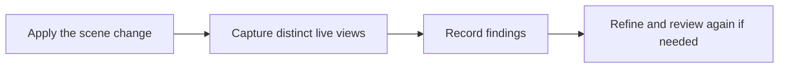

# `modeling.assess_quality`

> Records the assistant’s task-specific self-review of a changed scene; it does not change geometry or guarantee visual quality.

| | |
| --- | --- |
| Provider name | `modeling__assess_quality` |
| Type | Plan (permission `plan`) |
| Approval | Never |
| Needs the editor | Yes |
| Example | Live editor output; the test checks its shape |
| Defined in | `apps/backend/src/modules/tools/modeling/quality.tools.ts` |
| In the app | Documentation → Assistant tools → Plan |

## When the assistant uses it

- After applying changes for an explicit 3D realism, detail or refinement request.
- After capturing at least two distinct live solid views, or when explaining why review cannot proceed.

## Input

| Name | Type | Required | Default | Meaning |
| --- | --- | --- | --- | --- |
| `outcome` | ready \| needs_refinement \| blocked | Yes | – | Whether the assistant sees no major defects, identifies work to do, or is blocked. |
| `summary` | string 1–600 | Yes | – | Specific assessment or blocker. |
| `findings` | array of up to 8 findings | Yes | – | Each has aspect, observation, and severity (major or minor). |

## Evidence

| Item | Meaning |
| --- | --- |
| `ready / needs_refinement` | Require two distinct live solid views with images at the latest scene revision; ready rejects major findings and requires observations about at least two distinct aspects. |
| `blocked` | Explains an actual limitation with at least one finding and may be recorded without visual evidence. |
| `needs_refinement` | Requires a finding and another applied edit before the same revision can be marked ready. |

## Result

| Field | Meaning |
| --- | --- |
| `status: recorded` | Returns outcome, summary, findingCount and whether visual evidence was required. |
| `status: rejected` | Reason the review could not be recorded. |

## Example

Request:

```json
{
  "outcome": "blocked",
  "summary": "Images are unavailable, so the shape cannot be visually assessed.",
  "findings": [
    {
      "aspect": "visual evidence",
      "observation": "The model connection cannot receive images.",
      "severity": "major"
    }
  ]
}
```

Result:

```json
{
  "status": "recorded",
  "outcome": "blocked",
  "summary": "Images are unavailable, so the shape cannot be visually assessed.",
  "findingCount": 1,
  "evidence": "not required"
}
```

## How it fits



## Tips

- Prioritize visible task-specific issues and explain what is still missing.
- A blocked assessment permits an honest stop when images or needed capabilities are unavailable.

## Limits

- The assessment is the model’s fallible self-review, not an independent quality guarantee.
- Candidate previews and measurement-only captures do not count as live visual evidence.
- A scene revision change invalidates earlier visual evidence.

## Errors you may see

| Message | Cause |
| --- | --- |
| `Capture at least two distinct live solid views with images after the latest change, or record a concrete blocker.` | There is insufficient fresh image evidence. |

## Related

- [`viewport.capture`](viewport.capture.md)
- [`validation.check_scene`](validation.check_scene.md)
- [`editor.apply_proposal`](editor.apply_proposal.md)
