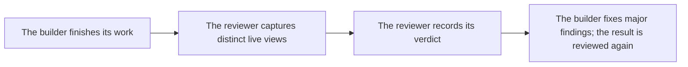

# `modeling.assess_quality`

> Records the independent reviewer's verdict on the finished work. Only the reviewer has this tool; the assistant that builds cannot grade itself.

| | |
| --- | --- |
| Provider name | `modeling__assess_quality` |
| Type | Plan (permission `plan`) |
| Approval | Never |
| Needs the editor | Yes |
| Example | Live editor output; the test checks its shape |
| Defined in | `apps/backend/src/modules/tools/modeling/quality.tools.ts` |
| In the app | Documentation → Assistant tools → Plan |

## When the assistant uses it

- Called by the quality reviewer, once, as its last step, after it has looked at the finished scene.
- Never by the assistant that built the result. It receives the findings as work to do.

## Input

| Name | Type | Required | Default | Meaning |
| --- | --- | --- | --- | --- |
| `outcome` | ready \| needs_refinement \| blocked | Yes | – | Whether the assistant sees no major defects, identifies work to do, or is blocked. |
| `summary` | string 1–600 | Yes | – | Specific assessment or blocker. |
| `findings` | array of up to 8 findings | Yes | – | Each has aspect, observation, severity (major or minor) and optionally fix: what to change, up to 240 characters. |

## Evidence

| Item | Meaning |
| --- | --- |
| `ready` | ready needs pictures of two distinct live solid views the reviewer took at the current scene, observations on at least two distinct aspects, no major finding, and a measured, passing brief. |
| `blocked` | Explains an actual limitation with at least one finding and may be recorded without visual evidence. |
| `needs_refinement` | Needs at least one major finding. When pictures are possible the reviewer must have looked first; without pictures the findings may rest on measurements. Only minor findings mean ready, not a request for work. |

## Result

| Field | Meaning |
| --- | --- |
| `status: recorded` | Returns outcome, summary, findingCount and whether visual evidence was required. |
| `status: rejected` | Reason the review could not be recorded. |

## Example

Request:

```json
{
  "outcome": "blocked",
  "summary": "Images are unavailable, so the shape cannot be visually assessed.",
  "findings": [
    {
      "aspect": "visual evidence",
      "observation": "The model connection cannot receive images.",
      "severity": "major"
    }
  ]
}
```

Result:

```json
{
  "status": "recorded",
  "outcome": "blocked",
  "summary": "Images are unavailable, so the shape cannot be visually assessed.",
  "findingCount": 1,
  "evidence": "not required"
}
```

## How it fits



## Tips

- Findings should say what is wrong, how serious it is, and what to change, so the builder can act on them.
- A review that cannot judge records blocked and says what could not be checked; a reviewer that gives no verdict is recorded as blocked, never as approval.

## Limits

- The verdict is a fallible judgment, but one made by an agent that did not build the result and starts with fresh context.
- Candidate previews and measurement-only captures do not count as live visual evidence.
- A scene revision change invalidates earlier visual evidence.

## Errors you may see

| Message | Cause |
| --- | --- |
| `A ready verdict needs pictures of at least two distinct live solid views taken after the latest change. If pictures are unavailable, record blocked and say the result was not visually verified.` | ready was recorded without enough fresh image evidence. |

## Related

- [`viewport.capture`](viewport.capture.md)
- [`validation.check_scene`](validation.check_scene.md)
- [`editor.apply_proposal`](editor.apply_proposal.md)
