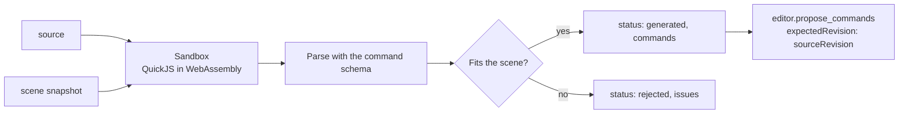

# `modeling.generate_commands`

Runs a short JavaScript function in an isolated sandbox and returns the editor commands it calculates. Loops, arrays and maths let the assistant describe a repeated or computed layout in a few lines. Nothing is applied or proposed.

| | |
| --- | --- |
| Provider name | `modeling__generate_commands` |
| Permission | `read` (never needs approval). It only computes. |
| Needs the editor | Yes, for the scene snapshot the program reads. The program itself runs in the backend. |
| Defined in | `apps/backend/src/modules/tools/procedural/procedural.tools.ts`, runner in `procedural.runner.ts` |
| Demo | [Calculate section of the Read tab](demos/index.html#read) |

## When the assistant uses it

For layouts with arithmetic in them: a row of posts, a ring of blocks, a grid, or a mesh whose vertices are computed. When the layout is simple, a direct `scene.transform_object` is cleaner.

## Input

| Field | Type | Required | Meaning |
| --- | --- | --- | --- |
| `source` | string, 1–16,000 characters | yes | The body of a synchronous function. `return` an array of commands. |
| `inspection` | mesh inspection request | no | When given, the inspected mesh is passed to the program as the second argument. |

The program receives `scene` (a JSON snapshot: `revision`, `objects`, `selectedObjectIds`, world bounds) and `mesh` (the inspection, or `null`).

## Result

```text
{ status: "generated", sourceRevision, commands }            on success
{ status: "rejected", sourceRevision, issues: [...] }        when a command does not fit the scene
{ status: "rejected", message: "..." }                       when the program fails
```

Commands are parsed by the same strict schema as `editor.propose_commands` before they are returned, so defaults such as `replaceExisting: false` appear in the result.

## Example

Request:

```json
{
  "source": "const posts = [];\nfor (let i = 0; i < 5; i += 1) {\n  posts.push({\n    commandId: \"post_\" + i,\n    type: \"geometry.create_primitive\",\n    objectId: \"post_\" + i,\n    primitive: \"box\",\n    size: 1,\n    name: \"Post\",\n    transform: { position: [i * 1.5, 0.5, -3] },\n  });\n}\nreturn posts;"
}
```

The program, as the model writes it:

```js
const posts = [];
for (let i = 0; i < 5; i += 1) {
  posts.push({
    commandId: "post_" + i,
    type: "geometry.create_primitive",
    objectId: "post_" + i,
    primitive: "box",
    size: 1,
    name: "Post",
    transform: { position: [i * 1.5, 0.5, -3] },
  });
}
return posts;
```

Result (one of five commands shown):

```json
{
  "status": "generated",
  "sourceRevision": 12,
  "commands": [
    { "commandId": "post_0", "type": "geometry.create_primitive", "objectId": "post_0", "primitive": "box", "size": 1, "replaceExisting": false, "name": "Post", "transform": { "position": [0, 0.5, -3] } },
    "…post_1 to post_4 at x = 1.5, 3, 4.5 and 6…"
  ]
}
```

## Visual example

Five boxes from the five `create_primitive` commands, top view:

```text
   z=-3   [Post] [Post] [Post] [Post] [Post]        each 1 unit wide, 1.5 apart
          x=0    1.5    3      4.5    6
```

## How it fits



The sandbox has no host functions, no imports, no files, no network and no timers. Each call starts a new interpreter.

## Limits and errors

- 250 ms of run time, 16 MiB of memory, 256 KiB of stack and 256,000 characters of output.
- Asynchronous code is not supported; a program must return an array synchronously.
- The result is 1–200 commands (`MAX_COMMANDS_PER_PROPOSAL`), with unique `commandId`s.
- Commands are validated against the snapshot: unknown objects and unsupported features (such as `transform` on a shape for an editor without `supportsSceneGraph`) are rejected with `issues`.
- Material and texture commands cannot be generated; they need their own proposals after [`editor.inspect_materials`](editor.inspect_materials.md).
- Nothing is proposed or applied. Pass the returned commands to [`editor.propose_commands`](editor.propose_commands.md) with `expectedRevision` set to `sourceRevision`.

## Related

- [`modeling.propose_generated`](modeling.propose_generated.md) runs the same program and stores the proposal in one step, without echoing the commands.
- [`editor.plan_duplicates`](editor.plan_duplicates.md) for copies of an existing object.
- [`editor.inspect_mesh`](editor.inspect_mesh.md), whose result can be passed in as `inspection`.
