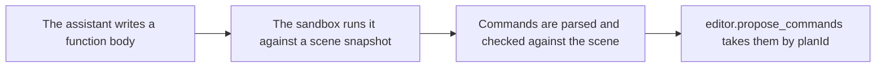

# `modeling.generate_commands`

> Runs a short JavaScript function in an isolated sandbox and returns the editor commands it calculates. Nothing is applied or proposed.

| | |
| --- | --- |
| Provider name | `modeling__generate_commands` |
| Type | Read (permission `read`) |
| Approval | Never |
| Needs the editor | Yes |
| Example | Checked by the backend test on the sample scene |
| Defined in | `apps/backend/src/modules/tools/procedural/procedural.tools.ts` |
| In the app | Documentation → Assistant tools → Read |

## When the assistant uses it

- For layouts with arithmetic in them: a row, a ring, a grid, or a mesh built from computed vertices.
- A direct scene.transform_object is simpler when the layout is simple.

## Input

| Name | Type | Required | Default | Meaning |
| --- | --- | --- | --- | --- |
| `source` | string, 1–16,000 characters | Yes | – | The body of a synchronous function. Return an array of commands. |
| `inspection` | mesh inspection request | No | – | When given, the inspected mesh is passed as the second argument, mesh. |

## What the program receives

| Item | Meaning |
| --- | --- |
| `scene` | A JSON snapshot: revision, objects, selectedObjectIds and world bounds. |
| `mesh` | The inspection, or null. |

## Sandbox limits

| Item | Meaning |
| --- | --- |
| `Time` | 250 ms of run time. |
| `Memory and stack` | 16 MiB of heap, 256 KiB of stack. |
| `Output` | 256,000 characters. 1–200 commands with unique commandIds. |
| `Not available` | Imports, files, network, timers and asynchronous code. |

## Result

| Field | Meaning |
| --- | --- |
| `status: generated` | sourceRevision, planId and commands, parsed by the strict command schema (defaults such as replaceExisting: false are filled in). Propose them by planId. |
| `status: rejected` | sourceRevision and issues (each with a commandId), or a message when the program failed. |

## Example

Program:

```js
const posts = [];
for (let i = 0; i < 5; i += 1) {
  posts.push({
    commandId: "post_" + i,
    type: "geometry.create_primitive",
    objectId: "post_" + i,
    primitive: "box",
    size: 1,
    name: "Post",
    transform: { position: [i * 1.5, 0.5, -3] },
  });
}
return posts;
```

Result:

```json
{
  "status": "generated",
  "sourceRevision": 12,
  "planId": "batch_1",
  "commands": [
    {
      "commandId": "post_0",
      "type": "geometry.create_primitive",
      "objectId": "post_0",
      "primitive": "box",
      "size": 1,
      "replaceExisting": false,
      "name": "Post",
      "transform": {
        "position": [
          0,
          0.5,
          -3
        ]
      }
    },
    {
      "commandId": "post_1",
      "type": "geometry.create_primitive",
      "objectId": "post_1",
      "primitive": "box",
      "size": 1,
      "replaceExisting": false,
      "name": "Post",
      "transform": {
        "position": [
          1.5,
          0.5,
          -3
        ]
      }
    },
    {
      "commandId": "post_2",
      "type": "geometry.create_primitive",
      "objectId": "post_2",
      "primitive": "box",
      "size": 1,
      "replaceExisting": false,
      "name": "Post",
      "transform": {
        "position": [
          3,
          0.5,
          -3
        ]
      }
    },
    {
      "commandId": "post_3",
      "type": "geometry.create_primitive",
      "objectId": "post_3",
      "primitive": "box",
      "size": 1,
      "replaceExisting": false,
      "name": "Post",
      "transform": {
        "position": [
          4.5,
          0.5,
          -3
        ]
      }
    },
    {
      "commandId": "post_4",
      "type": "geometry.create_primitive",
      "objectId": "post_4",
      "primitive": "box",
      "size": 1,
      "replaceExisting": false,
      "name": "Post",
      "transform": {
        "position": [
          6,
          0.5,
          -3
        ]
      }
    }
  ]
}
```

## How it fits



## Tips

- Use a program when the layout has arithmetic or repetition. Use direct commands for one or two edits.
- Use geometry.create_mesh for custom shapes: 3–4096 vertices, 1–4096 faces, and no more than 20,000 triangles.

## Limits

- Nothing is proposed or applied. Pass the planId to editor.propose_commands, which carries sourceRevision as expectedRevision.
- Material and texture commands cannot be generated. They need a separate proposal after editor.inspect_materials.

## Errors you may see

| Message | Cause |
| --- | --- |
| `The arguments do not match this tool's schema` | The source is empty or longer than 16,000 characters, or the inspection request is invalid. issues names each field. |
| `TypeError: … (line 2 of your source)` | status rejected: the program threw. The message is the program's own error and the line in the submitted source. |
| `The returned commands do not match the command schema: commands[1] (commandId "…").transform.scale: …` | status rejected: the program returned a command of the wrong shape, named by position and commandId. |
| `Scene program stopped: it ran past 250ms, ran out of memory, or has a syntax error` | status rejected: the sandbox stopped the program. |

## Related

- [`modeling.propose_generated`](modeling.propose_generated.md)
- [`editor.plan_duplicates`](editor.plan_duplicates.md)
- [`editor.inspect_mesh`](editor.inspect_mesh.md)
