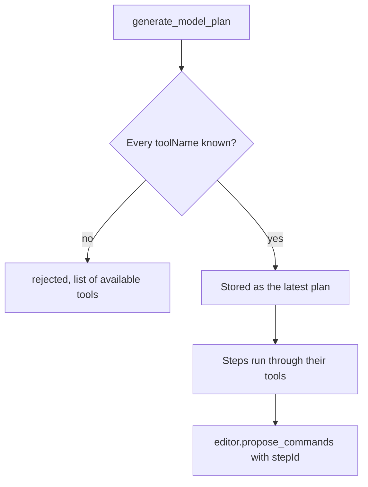

# `modeling.generate_model_plan`

Records a structured plan for the task: the goal, the dimension being modelled, and an ordered list of steps. Each step names the tool that carries it out. Recording a plan changes nothing in the scene.

| | |
| --- | --- |
| Provider name | `modeling__generate_model_plan` |
| Permission | `plan` (never needs approval). Records intent only. |
| Needs the editor | No |
| Defined in | `apps/backend/src/modules/tools/modeling/modeling.tools.ts` |
| Schema | `modelingPlanSchema` in `apps/backend/src/shared/schemas/modeling-plan.schema.ts` |
| Demo | [Plan tab](demos/index.html#plan) |

## When the assistant uses it

At the start of a multi-step change, before any proposal. A plan lets the user see what will happen, and it lets later proposals say which step they carry out (`stepId` on `editor.propose_commands`).

## Input

| Field | Type | Meaning |
| --- | --- | --- |
| `goal` | string, 1–500 characters | What the user wants. |
| `dimension` | `2d`, `2.5d` or `3d` | The kind of model. |
| `steps` | 1–30 steps | Ordered. Each step below. |

Each step:

| Field | Type | Meaning |
| --- | --- | --- |
| `id` | `[a-z0-9-]`, 1–40 characters | Unique within the plan. Proposals refer to it. |
| `title` | string, 1–120 characters | Short name for the user. |
| `toolName` | string | A tool the assistant can call. |
| `description` | string, up to 500 characters | What the step does. |
| `requiresApproval` | boolean, default `false` | Recorded for the user. Assistant proposals apply automatically. |

## Result

On success:

```json
{ "status": "recorded", "planNumber": 1, "stepCount": 4 }
```

If a step names a tool that does not exist, nothing is recorded:

```json
{ "status": "rejected", "reason": "Plan references unknown tools. ...", "unknownTools": ["..."], "availableTools": ["..."] }
```

## Example

Request:

```json
{
  "goal": "Add a row of posts beside the figure and check the result",
  "dimension": "3d",
  "steps": [
    { "id": "read-scene", "title": "Read the scene", "toolName": "editor.get_context", "description": "Confirm the figure and crate ids and the current revision.", "requiresApproval": false },
    { "id": "make-posts", "title": "Generate five posts", "toolName": "modeling.propose_generated", "description": "Run a bounded program that places five boxes in a row.", "requiresApproval": false },
    { "id": "review", "title": "Review from the front", "toolName": "viewport.capture", "description": "Capture a front view to check spacing and height.", "requiresApproval": false },
    { "id": "apply", "title": "Apply and check", "toolName": "editor.apply_proposal", "description": "Apply the stored proposal, then run the scene check.", "requiresApproval": false }
  ]
}
```

Result:

```json
{ "status": "recorded", "planNumber": 1, "stepCount": 4 }
```

## Visual example

```text
Goal: Add a row of posts beside the figure and check the result   [3d]

 (1) Read the scene             editor.get_context
  |   Confirm the figure and crate ids and the current revision.
 (2) Generate five posts        modeling.propose_generated
  |   Run a bounded program that places five boxes in a row.
 (3) Review from the front      viewport.capture
  |   Capture a front view to check spacing and height.
 (4) Apply and check            editor.apply_proposal
      Apply the stored proposal, then run the scene check.
```

## How it fits



Only the latest plan counts. A newer plan replaces the current one, and `stepId` on a proposal is checked against the latest plan.

## Limits and errors

- A plan with no steps, more than 30 steps, or a step id that is not `[a-z0-9-]` is rejected by the schema.
- A `stepId` that is not in the latest plan makes `editor.propose_commands` return `rejected` with the step ids that are available. Nothing is stored.
- The plan is not persisted with the project. It lasts for the run.

## Related

- [`editor.propose_commands`](editor.propose_commands.md), which can name a plan step.
- [`skills.load_skill`](skills.load_skill.md), which supplies the workflow a plan usually follows.
