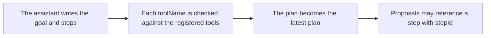

# `modeling.generate_model_plan`

> Writes down the goal and the ordered steps, and the tool each step will use. Recording a plan changes nothing in the scene.

| | |
| --- | --- |
| Provider name | `modeling__generate_model_plan` |
| Type | Plan (permission `plan`) |
| Approval | Never |
| Needs the editor | No |
| Example | Checked by the backend test on the sample scene |
| Defined in | `apps/backend/src/modules/tools/modeling/modeling.tools.ts` |
| In the app | Documentation → Assistant tools → Plan |

## When the assistant uses it

- At the start of a multi-step change, before any proposal.
- So the user can see what will happen, and so proposals can name the step they carry out with stepId.

## Input

| Name | Type | Required | Default | Meaning |
| --- | --- | --- | --- | --- |
| `goal` | string 1–500 | Yes | – | What the user wants. |
| `dimension` | 3d | Yes | – | The kind of model. |
| `steps` | array of 1–30 steps | Yes | – | Ordered. Each step is described below. |

## Step fields

| Item | Meaning |
| --- | --- |
| `id` | [a-z0-9-], 1–40 characters, unique in the plan. |
| `title` | Short name, up to 120 characters. |
| `toolName` | A tool the assistant can call. Unknown names are rejected. |
| `description` | What the step does, up to 500 characters. |
| `requiresApproval` | Recorded for the user, default false. Assistant proposals still apply automatically. |

## Result

| Field | Meaning |
| --- | --- |
| `status: recorded` | planNumber and stepCount. |
| `status: rejected` | reason, unknownTools and availableTools. |

## Example

Request:

```json
{
  "goal": "Add a row of posts beside the figure and check the result",
  "dimension": "3d",
  "steps": [
    {
      "id": "read-scene",
      "title": "Read the scene",
      "toolName": "editor.get_context",
      "description": "Confirm the figure and crate ids and the current revision.",
      "requiresApproval": false
    },
    {
      "id": "make-posts",
      "title": "Generate five posts",
      "toolName": "modeling.propose_generated",
      "description": "Run a bounded program that places five boxes in a row.",
      "requiresApproval": false
    },
    {
      "id": "review",
      "title": "Review from the front",
      "toolName": "viewport.capture",
      "description": "Capture a front view to check spacing and height.",
      "requiresApproval": false
    },
    {
      "id": "apply",
      "title": "Apply and check",
      "toolName": "editor.apply_proposal",
      "description": "Apply the stored proposal, then run the scene check.",
      "requiresApproval": false
    }
  ]
}
```

Result:

```json
{
  "status": "recorded",
  "planNumber": 1,
  "stepCount": 4
}
```

## How it fits



## Tips

- Keep steps small: each should map to one tool call.
- A newer plan replaces the current one, and stepId is checked against the latest plan only.

## Limits

- A plan lasts for the run. It is not saved with the project.
- Up to 30 steps.

## Errors you may see

| Message | Cause |
| --- | --- |
| `Plan references unknown tools. Each step's toolName must be one of the available tools.` | A step names a tool that is not registered. The result lists unknownTools and availableTools. |

## Related

- [`editor.propose_commands`](editor.propose_commands.md)
- [`skills.load_skill`](skills.load_skill.md)
