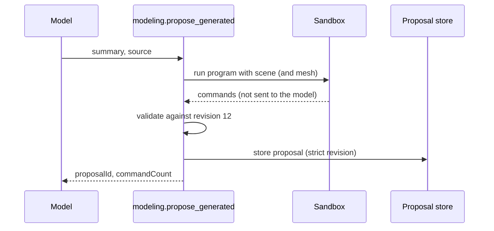

# `modeling.propose_generated`

Runs a program the same way as [`modeling.generate_commands`](modeling.generate_commands.md), checks its commands against the scene, and stores them as a proposal. The commands are not returned to the model. It is the efficient path for a large batch, because the model reads only the proposal's id and count.

| | |
| --- | --- |
| Provider name | `modeling__propose_generated` |
| Permission | `propose` (never needs approval). It stores; it does not apply. |
| Needs the editor | Yes, for the scene snapshot and the check |
| Defined in | `apps/backend/src/modules/tools/procedural/procedural.tools.ts` |
| Demo | [Propose tab](demos/index.html#propose) |

## When the assistant uses it

When the result has many commands (a grid of hundreds of blocks, or a mesh built from many vertices) and echoing them back would waste context. The `mesh-editing` skill recommends it for larger generated arrays.

## Input

| Field | Type | Required | Meaning |
| --- | --- | --- | --- |
| `summary` | string, 1–300 characters | yes | What the proposal does. |
| `source` | string, 1–16,000 characters | yes | The function body, as for `modeling.generate_commands`. |
| `inspection` | mesh inspection request | no | When given, the mesh is passed to the program. Use `faceQuery` with `includeSamples: false` to target faces by id. |

## Result

On success:

```json
{
  "proposalId": "prp_3a9d0c5e2b7f4a61",
  "status": "proposed",
  "summary": "Five posts in a row",
  "requiresApproval": false,
  "commandCount": 5,
  "baseRevision": 12
}
```

If the program fails or a command does not fit:

```json
{ "status": "rejected", "message": "...", "sourceRevision": 12 }
```
```json
{ "status": "rejected", "sourceRevision": 12, "issues": [ { "commandId": "post_3", "message": "..." } ] }
```

## Example

Request:

```json
{
  "summary": "Five posts in a row",
  "source": "const posts = [];\nfor (let i = 0; i < 5; i += 1) {\n  posts.push({\n    commandId: \"post_\" + i,\n    type: \"geometry.create_primitive\",\n    objectId: \"post_\" + i,\n    primitive: \"box\",\n    size: 1,\n    name: \"Post\",\n    transform: { position: [i * 1.5, 0.5, -3] },\n  });\n}\nreturn posts;"
}
```

Result: the proposal shown above. Review it with [`viewport.capture`](viewport.capture.md) by passing the `proposalId`, then apply it.

## Visual example

```text
Program ──► sandbox ──► 5 commands ──► check at revision 12 ──► stored  prp_3a9d0c5e2b7f4a61
                                                                  │
                          the model sees: id, status, count only  │
                                                                  ▼
                                                    viewport.capture (proposalId) ──► apply
```

## How it fits



It is strict: `expectedRevision` is the scene's current revision. If the scene changes before the proposal is applied, the proposal fails and the program must be run again.

## Limits and errors

- The same sandbox limits as `modeling.generate_commands`: 250 ms, 16 MiB, 16,000 source characters.
- At most 200 commands per proposal.
- Truncated inspection pages should not be used for face ids. Check `faceMatches.hasMore` before relying on a page.
- Programs cannot reach files, the network or the host.

## Related

- [`modeling.generate_commands`](modeling.generate_commands.md), which returns the commands so they can be read first.
- [`viewport.capture`](viewport.capture.md) for reviewing the stored proposal.
- [`editor.apply_proposal`](editor.apply_proposal.md) to apply it.
