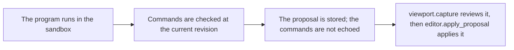

# `modeling.propose_generated`

> Runs the same sandbox program as modeling.generate_commands, then stores the result as a proposal. The commands are not echoed back to the model.

| | |
| --- | --- |
| Provider name | `modeling__propose_generated` |
| Type | Propose (permission `propose`) |
| Approval | Never |
| Needs the editor | Yes |
| Example | Checked by the backend test on the sample scene |
| Defined in | `apps/backend/src/modules/tools/procedural/procedural.tools.ts` |
| In the app | Documentation → Assistant tools → Propose |

## When the assistant uses it

- When the command list would be long, such as a grid of hundreds of blocks, so the model reads only the proposal id and count.
- The mesh-editing skill recommends it for larger generated arrays.

## Input

| Name | Type | Required | Default | Meaning |
| --- | --- | --- | --- | --- |
| `summary` | string 1–300 | Yes | – | What the proposal does. |
| `source` | string 1–16,000 | Yes | – | The function body, as for modeling.generate_commands. |
| `inspection` | mesh inspection request | No | – | When given, the mesh is passed to the program. Use faceQuery with includeSamples false to target faces by id. |
| `stepId` | identifier | No | – | A step of the latest plan that this batch carries out. |
| `apply` | boolean | No | – | true applies the proposal in this call. Leave it out to review it with viewport.capture first. |

## Result

| Field | Meaning |
| --- | --- |
| `proposalId, status, commandCount, baseRevision` | The stored proposal, proposed, with its size and the revision it was checked on. With apply true, also the apply outcome: status, revision, results, message, rebased. |
| `status: rejected` | A message when the program failed, or issues (each with a commandId) when a command does not fit. |

## Example

Program:

```js
const posts = [];
for (let i = 0; i < 5; i += 1) {
  posts.push({
    commandId: "post_" + i,
    type: "geometry.create_primitive",
    objectId: "post_" + i,
    primitive: "box",
    size: 1,
    name: "Post",
    transform: { position: [i * 1.5, 0.5, -3] },
  });
}
return posts;
```

Request:

```json
{
  "summary": "Five posts in a row"
}
```

Result:

```json
{
  "proposalId": "prp_3a9d0c5e2b7f4a61",
  "status": "proposed",
  "summary": "Five posts in a row",
  "requiresApproval": false,
  "commandCount": 5,
  "baseRevision": 12
}
```

## How it fits



## Tips

- Inspect faces with faceQuery and includeSamples false, then pass the ids in the program through mesh.faceMatches.ids.
- Check faceMatches.hasMore before using a page.

## Limits

- Same sandbox limits as modeling.generate_commands.
- At most 200 commands per proposal. Programs cannot reach files, the network or the host.

## Related

- [`modeling.generate_commands`](modeling.generate_commands.md)
- [`viewport.capture`](viewport.capture.md)
- [`editor.apply_proposal`](editor.apply_proposal.md)
