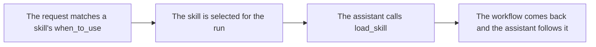

# `skills.load_skill`

> Loads the full workflow for a skill that was selected for this request, so only the instructions the task needs enter the prompt.

| | |
| --- | --- |
| Provider name | `skills__load_skill` |
| Type | Skill (permission `skill`) |
| Approval | Never |
| Needs the editor | No |
| Example | Checked by the backend test on the sample scene |
| Defined in | `apps/backend/src/modules/tools/skills/skills.tools.ts` |
| In the app | Documentation → Assistant tools → Skill |

## When the assistant uses it

- When the request matches a skill's when_to_use, so the skill is selected for the run.
- The model then calls this tool once to read the workflow.

## Input

| Name | Type | Required | Default | Meaning |
| --- | --- | --- | --- | --- |
| `skillId` | string, up to 64, [a-z0-9][a-z0-9.-]{1,63} | Yes | – | The skill's folder name, such as mesh-editing. |

## Result statuses

| Item | Meaning |
| --- | --- |
| `loaded` | The skill was selected and found. The result holds version, instructions, toolNames, validation and errorHandling. |
| `not_selected` | The skill was not selected for this request. Nothing is loaded; availableSkillIds lists the ones that can be. |
| `not_found` | No skill has that id. |

## Result

| Field | Meaning |
| --- | --- |
| `status, skillId, version` | Which skill was loaded and its version. |
| `instructions` | The whole body of SKILL.md. |
| `toolNames` | The tools the workflow names. Informational: the model still receives every tool. |
| `validation, errorHandling` | The checks to run and what to do when something goes wrong. |

## Example

Request:

```json
{
  "skillId": "mesh-editing"
}
```

Result:

```json
{
  "status": "loaded",
  "skillId": "mesh-editing",
  "version": "1.10.0",
  "instructions": "# Mesh editing workflow\n\n1. Call `editor.get_context` and confirm every target object exists.\n2. Describe the change in plain language, then build the smallest set of commands that achieves it.\n… (the rest of the workflow is in skills/mesh-editing/SKILL.md)",
  "toolNames": [
    "editor.get_context",
    "editor.read_branch",
    "editor.find_repeats",
    "editor.query_objects",
    "editor.inspect_mesh",
    "editor.inspect_materials",
    "editor.measure",
    "editor.plan_placement",
    "editor.plan_duplicates",
    "viewport.capture",
    "modeling.generate_commands",
    "modeling.propose_generated",
    "editor.propose_commands",
    "editor.apply_proposal",
    "validation.check_scene"
  ],
  "validation": [
    "Each target object id exists in the latest editor context.",
    "Transforms use finite numbers, and scale values are positive.",
    "Replacing geometry is an explicit destructive command and applies automatically through a proposal."
  ],
  "errorHandling": [
    "If a target object is missing, stop and ask the user which object to change.",
    "If the user rejects a destructive proposal, do not retry it. Propose a non-destructive alternative instead.",
    "Report revision conflicts, read the current context, and recalculate before proposing corrected commands."
  ]
}
```

## How it fits



## Tips

- Only selected skills load, so a workflow for another task cannot enter the prompt.

## Limits

- The registry loads skills once, when the backend starts. Restart the backend after editing a SKILL.md.
- A skill file must be at most 64 KiB.

## Related

- [`modeling.generate_model_plan`](modeling.generate_model_plan.md)
- [`editor.propose_commands`](editor.propose_commands.md)
