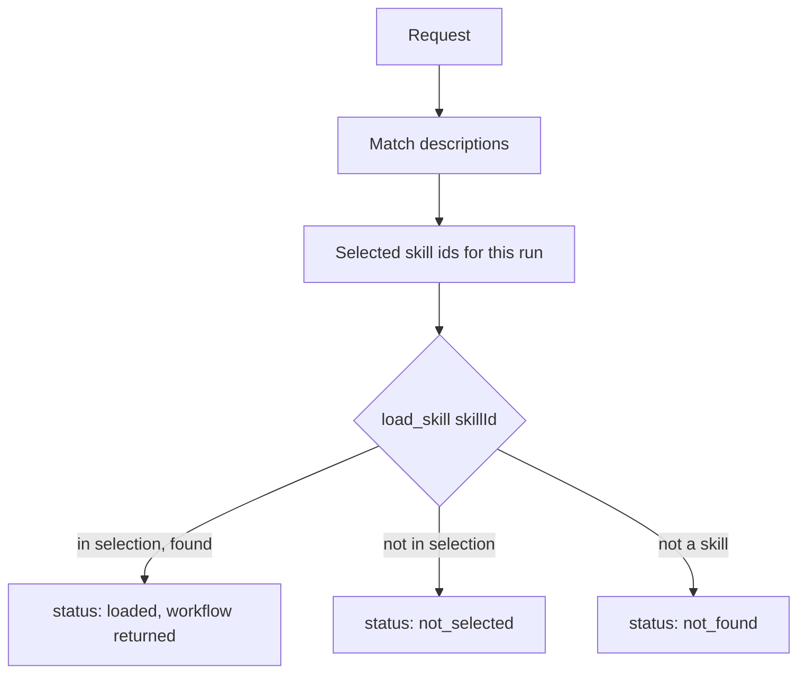

# `skills.load_skill`

Loads the full workflow for a skill that was selected for this request. Skills are kept out of the prompt until they are needed, so only the instructions relevant to the task take up room.

| | |
| --- | --- |
| Provider name | `skills__load_skill` |
| Permission | `skill` (never needs approval). Loads instructions; changes nothing. |
| Needs the editor | No |
| Defined in | `apps/backend/src/modules/tools/skills/skills.tools.ts` |
| Skill files | `skills/<id>/SKILL.md` |
| Demo | [Skill tab](demos/index.html#skill) |

## When the assistant uses it

When a request matches a skill's `when_to_use` (for example, a request to move, scale or cut existing geometry matches `mesh-editing`). The skills that match are selected for the run, and the model then calls this tool to read the full workflow of a selected skill.

## Input

| Field | Type | Required | Meaning |
| --- | --- | --- | --- |
| `skillId` | string, up to 64 characters, `[a-z0-9][a-z0-9.-]{1,63}` | yes | The skill's folder name, such as `mesh-editing`. |

## Result

When the skill was selected:

```json
{
  "status": "loaded",
  "skillId": "mesh-editing",
  "version": "1.7.0",
  "instructions": "# Mesh editing workflow\n\n1. Call `editor.get_context` and confirm every target object exists.\n…",
  "toolNames": ["editor.get_context", "editor.inspect_mesh", "…", "validation.check_scene"],
  "validation": ["Each target object id exists in the latest editor context.", "…"],
  "errorHandling": ["If a target object is missing, stop and ask the user which object to change.", "…"]
}
```

`instructions` is the whole body of `SKILL.md`. The demo page shortens it.

Otherwise:

- `{ "status": "not_selected", "skillId": "..." }`: the skill exists but was not selected for this request. Nothing is loaded.
- `{ "status": "not_found", "skillId": "..." }`: no skill has that id.

A `skill.loaded` event is sent to the run when the skill is loaded.

## Example

Request:

```json
{ "skillId": "mesh-editing" }
```

Result: the loaded result above, with `version` `1.7.0`.

## Visual example

```text
skill: mesh-editing  v1.7.0   status: loaded

tools named:    editor.get_context  editor.inspect_mesh  editor.measure  ...  validation.check_scene
validation:     ✓ ids exist in the latest context
                ✓ finite transforms, positive scale
                ✓ destructive replacement goes through a proposal
on error:       ✗ stop and ask if an object is missing
                ✗ do not retry a rejected destructive proposal
                ✗ on a revision conflict, read the scene and recalculate
```

## How it fits



Only skills selected for the request can be loaded, so a skill about another task cannot be pulled in by the model.

## Limits and errors

- The skill id must match the pattern, and the skill file must be at most 64 KiB.
- The skill's `tools:` list is informational. The model still receives every registered tool.
- The registry loads the skills once, when the backend starts (`SkillsRegistry.onModuleInit`). A changed `SKILL.md` takes effect after the backend restarts.

## Related

- The skill files: [`mesh-editing`](../../skills/mesh-editing/SKILL.md), [`character-modeling`](../../skills/character-modeling/SKILL.md), [`2.5d-character-design`](../../skills/2.5d-character-design/SKILL.md).
- [`modeling.generate_model_plan`](modeling.generate_model_plan.md), which often follows a loaded workflow.
- [`docs/assistant-tools.md`](../assistant-tools.md#skills-and-the-tools-they-name) lists the tools each skill names.
