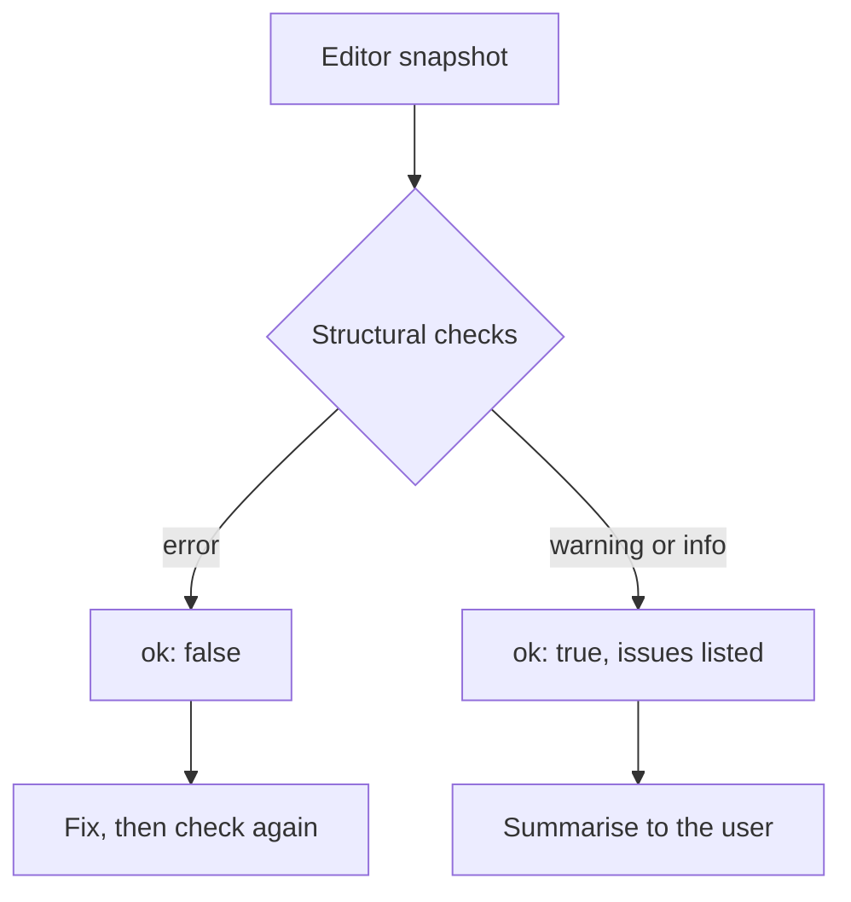

# `validation.check_scene`

Checks the current scene for structural problems and reports them with a severity. It finds duplicate ids, missing parents, cycles, invalid scale, shared names, uneven group scales and empty groups or collections.

| | |
| --- | --- |
| Provider name | `validation__check_scene` |
| Permission | `read` (never needs approval) |
| Needs the editor | Yes, to read the snapshot. The checks themselves are plain code. |
| Defined in | `apps/backend/src/modules/tools/validation/validation.tools.ts` |
| Demo | [Read tab](demos/index.html#read) |

## When the assistant uses it

As the last step of a change: the `mesh-editing` and `character-modeling` skills both call it after the change is applied. It is also used whenever the user asks whether the scene is in order.

## Input

None. The input must be `{}`.

## Result

| Field | Meaning |
| --- | --- |
| `ok` | `false` only when there is at least one `error`. Warnings and information do not make it false. |
| `objectCount` | Objects in the snapshot. |
| `issues` | One entry per problem: `severity` (`error`, `warning` or `info`), `objectId` (or `null` for a collection or scene-wide issue) and `message`. |

What is checked:

| Severity | Check |
| --- | --- |
| error | Duplicate object ids. |
| error | A scale that is zero or negative on any axis. |
| error | A parent that does not exist, or a parent chain that loops. |
| error | A collection that sits in a missing collection, or inside itself. |
| error | An object in a collection that does not exist. |
| warning | Two objects with the same name under the same parent (the later one is reported). |
| warning | Two collections with the same name in the same place. |
| warning | A group with children scaled by different amounts on different axes. A turned child cannot be moved under or out of it exactly. |
| warning | A selected id that is not in the scene. |
| warning | More than 500 objects, where checks may be slow to review. |
| info | A group with no children, or a collection with nothing in it. |

## Example

Request: `{}`

Result, for the sample scene (`arm_right` shares the name `Arm` with `arm_left`, and `props` is an empty group):

```json
{
  "ok": true,
  "objectCount": 6,
  "issues": [
    { "severity": "warning", "objectId": "arm_right", "message": "Shares the name \"Arm\" with another object under the same parent; rename one so each can be told apart" },
    { "severity": "info", "objectId": "props", "message": "Group has no children" }
  ]
}
```

## Visual example

```text
ok: true   6 objects checked

[warning] arm_right  Shares the name "Arm" with another object under the same parent
[info   ] props      Group has no children

Objects:  Figure  Torso  [Arm]  [Arm]  Crate  [Props]     ([ ] = flagged)
```

## How it fits



The checks are the same plain functions the unit tests run, so the result is deterministic for a given snapshot.

## Limits and errors

- It sees only the snapshot. It does not evaluate geometry, so it cannot find self-intersections or overlapping shapes. Use [`editor.measure`](editor.measure.md) or [`viewport.capture`](viewport.capture.md) for those.
- A warning does not stop an edit. A later move under or out of an unevenly scaled group is refused by [`editor.propose_commands`](editor.propose_commands.md), so the warning is worth fixing first.

## Related

- [`editor.get_context`](editor.get_context.md) for the snapshot the check reads.
- [`editor.apply_proposal`](editor.apply_proposal.md), usually called just before this.
