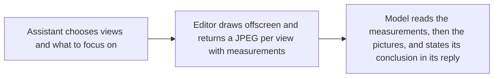

# `viewport.capture`

> Lets the assistant look at the scene. The editor draws it from one to six views and returns the pictures, with where each object sits in each one.

| | |
| --- | --- |
| Provider name | `viewport__capture` |
| Type | Read (permission `read`) |
| Approval | Never |
| Needs the editor | Yes |
| Example | Live editor output; the test checks its shape |
| Defined in | `apps/backend/src/modules/tools/viewport/viewport.tools.ts` |
| In the app | Documentation → Assistant tools → Read |

## When the assistant uses it

- To check shapes, proportions, placement and surface problems that numbers cannot show.
- Before applying a proposal, by passing its proposalId.

## Input

| Name | Type | Required | Default | Meaning |
| --- | --- | --- | --- | --- |
| `views` | 1–6 views | Yes | – | Each view places the camera by preset, orbit or exact camera, with optional label, projection and zoom. |
| `proposalId` | identifier | No | – | Draw this pending proposal from the run as an isolated copy. |
| `focus, highlight` | up to 50 ids each | No | – | Objects to frame and report bounds for; objects to box in orange. |
| `isolate` | boolean | No | – | Draw only the focused objects. |
| `mode` | solid \| wireframe \| normals | No | `solid` | normals shows flipped or faceted faces. |
| `labels, guides` | boolean | No | `true` | Object ids on the picture; a floor grid and axes. |
| `width, height` | integers 128–1024 | No | `768 × 576` | Image size in pixels. |

## Camera placement, in order of priority

| Item | Meaning |
| --- | --- |
| `camera` | Exact position, target and optional fov, in world space. |
| `orbit` | azimuthDegrees and elevationDegrees around the framed objects. Azimuth 0 looks at the front from +Z. |
| `preset` | front, back, left, right, top, bottom, isometric (default), or current for the user's own camera. |

## Result

| Field | Meaning |
| --- | --- |
| `status, coordinates, note` | The result status, the axis conventions, and how to read the measurements. |
| `scene` | Object count and the bounds of everything. |
| `focus` | For each focused object: bounds, size and center. |
| `views[]` | label, size, camera used, and each listed object's screenBounds and inFrame. |
| `proposalId` | Present when a proposal was drawn. |

## Example

Request:

```json
{
  "views": [
    {
      "label": "Front",
      "preset": "front"
    },
    {
      "label": "Top",
      "preset": "top"
    }
  ],
  "focus": [
    "figure",
    "torso",
    "arm_left",
    "arm_right"
  ],
  "mode": "solid",
  "width": 512,
  "height": 384
}
```

Result:

```json
{
  "status": "ok",
  "coordinates": "Y is up. A front view looks along -Z (it sees the +Z side), a right view looks along -X, a left view looks along +X, a back view looks along +Z.",
  "scene": {
    "objectCount": 6,
    "bounds": {
      "min": [
        -1.05,
        0,
        -0.5
      ],
      "max": [
        3.5,
        1.8,
        0.5
      ]
    }
  },
  "focus": [
    {
      "id": "figure",
      "name": "Figure",
      "bounds": {
        "min": [
          -1.05,
          0.25,
          -0.3
        ],
        "max": [
          1.05,
          1.8,
          0.3
        ]
      },
      "size": [
        2.1,
        1.55,
        0.6
      ],
      "center": [
        0,
        1.025,
        0
      ]
    },
    {
      "id": "torso",
      "name": "Torso",
      "bounds": {
        "min": [
          -0.5,
          0.25,
          -0.3
        ],
        "max": [
          0.5,
          1.75,
          0.3
        ]
      },
      "size": [
        1,
        1.5,
        0.6
      ],
      "center": [
        0,
        1,
        0
      ]
    },
    {
      "id": "arm_left",
      "name": "Arm",
      "bounds": {
        "min": [
          -1.05,
          0.6,
          -0.15
        ],
        "max": [
          -0.75,
          1.8,
          0.15
        ]
      },
      "size": [
        0.3,
        1.2,
        0.3
      ],
      "center": [
        -0.9,
        1.2,
        0
      ]
    },
    {
      "id": "arm_right",
      "name": "Arm",
      "bounds": {
        "min": [
          0.75,
          0.6,
          -0.15
        ],
        "max": [
          1.05,
          1.8,
          0.15
        ]
      },
      "size": [
        0.3,
        1.2,
        0.3
      ],
      "center": [
        0.9,
        1.2,
        0
      ]
    }
  ],
  "missingIds": [],
  "views": [
    {
      "image": 1,
      "label": "Front",
      "width": 512,
      "height": 384,
      "camera": {
        "projection": "orthographic",
        "position": [
          0,
          1.025,
          10
        ],
        "target": [
          0,
          1.025,
          0
        ],
        "fov": null,
        "orthographicHeight": 2.9
      },
      "objects": [
        {
          "id": "figure",
          "name": "Figure",
          "screenBounds": {
            "x": 117,
            "y": 89,
            "width": 278,
            "height": 205
          },
          "inFrame": true
        },
        {
          "id": "torso",
          "name": "Torso",
          "screenBounds": {
            "x": 190,
            "y": 96,
            "width": 132,
            "height": 199
          },
          "inFrame": true
        },
        {
          "id": "arm_left",
          "name": "Arm",
          "screenBounds": {
            "x": 117,
            "y": 89,
            "width": 40,
            "height": 159
          },
          "inFrame": true
        },
        {
          "id": "arm_right",
          "name": "Arm",
          "screenBounds": {
            "x": 355,
            "y": 89,
            "width": 40,
            "height": 159
          },
          "inFrame": true
        }
      ]
    },
    {
      "image": 2,
      "label": "Top",
      "width": 512,
      "height": 384,
      "camera": {
        "projection": "orthographic",
        "position": [
          0,
          10,
          0.01
        ],
        "target": [
          0,
          1.025,
          0
        ],
        "fov": null,
        "orthographicHeight": 2.9
      },
      "objects": [
        {
          "id": "figure",
          "name": "Figure",
          "screenBounds": {
            "x": 117,
            "y": 152,
            "width": 278,
            "height": 80
          },
          "inFrame": true
        },
        {
          "id": "torso",
          "name": "Torso",
          "screenBounds": {
            "x": 190,
            "y": 152,
            "width": 132,
            "height": 80
          },
          "inFrame": true
        },
        {
          "id": "arm_left",
          "name": "Arm",
          "screenBounds": {
            "x": 117,
            "y": 172,
            "width": 40,
            "height": 40
          },
          "inFrame": true
        },
        {
          "id": "arm_right",
          "name": "Arm",
          "screenBounds": {
            "x": 355,
            "y": 172,
            "width": 40,
            "height": 40
          },
          "inFrame": true
        }
      ]
    }
  ],
  "note": "The images follow in the order of views. screenBounds is each object's projected bounding box in pixels, not a visibility test."
}
```

## How it fits



## Tips

- Start with overview views, then focus and zoom into anything suspicious.
- Pass proposalId to check a stored proposal before it is applied.

## Limits

- Up to six views per call; each JPEG stays under about 1.5 MB.
- The call times out after EDITOR_REQUEST_TIMEOUT_MS (15 seconds by default).
- An OpenAI-compatible endpoint receives the pictures in the message after the tool result, for the latest four captures; earlier ones keep their measurements. Turn Send pictures off in the provider settings for a model that cannot read images, and the assistant gets measurements only.
- The editor window keeps the last 12 captures. Pictures are not kept in the saved conversation.

## Related

- [`editor.propose_commands`](editor.propose_commands.md)
- [`modeling.propose_generated`](modeling.propose_generated.md)
- [`validation.check_scene`](validation.check_scene.md)
