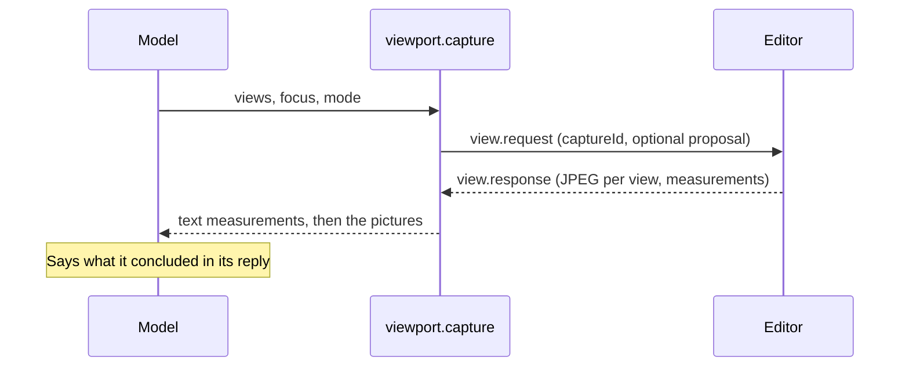

# `viewport.capture`

Lets the assistant look at the scene. The editor draws it from one to six points of view and returns the pictures, plus where each object sits in each picture and how the camera was placed. It can also draw an unapplied proposal before the user relies on it.

| | |
| --- | --- |
| Provider name | `viewport__capture` |
| Permission | `read` (never needs approval). Nothing in the scene changes. |
| Needs the editor | Yes. The editor draws offscreen and sends back JPEG images. |
| Defined in | `apps/backend/src/modules/tools/viewport/viewport.tools.ts` |
| Schema | `viewCaptureRequestSchema` in `packages/editor-protocol/src/view-capture.schema.ts` |
| Demo | [Read tab](demos/index.html#read) |

## When the assistant uses it

To check shapes, proportions, placement and surface problems that a list of numbers cannot show: after an edit, before a proposal is applied (with `proposalId`), and when the user asks what something looks like.

## Input

| Field | Type | Meaning |
| --- | --- | --- |
| `views` | 1–6 views | Each view has one way to place the camera (below), an optional `label`, `projection` (`perspective` or `orthographic`) and `zoom` (0.25–20). |
| `proposalId` | identifier | Draw this pending proposal from the current run as an isolated copy. Omit it to draw the live scene. |
| `focus` | up to 50 ids | Objects to frame, and whose exact bounds are reported. Without it the view frames the whole scene. |
| `highlight` | up to 50 ids | Objects to box in orange in the picture. |
| `isolate` | boolean | Draw only the focused objects. |
| `mode` | `solid`, `wireframe` or `normals` | `wireframe` shows mesh structure; `normals` shows surface direction, so flipped or faceted faces stand out. |
| `labels`, `guides` | boolean, default `true` | Write object ids on the picture; draw a floor grid and axes (X red, Y green, Z blue). |
| `width`, `height` | integers 128–1024 | Image size in pixels. Default 768 × 576. |

A view places its camera in one of three ways, in this order of priority:

1. `camera`: exact `position`, `target` and optional `fov` (10–120), in world space.
2. `orbit`: `azimuthDegrees` and `elevationDegrees` around the framed objects. Azimuth 0 looks at the front from +Z; 90 from +X; 180 from behind. Elevation 0 is level; 90 is straight down.
3. `preset`: `front`, `back`, `left`, `right`, `top`, `bottom`, `isometric` (default), or `current` for the user's own camera.

Y is up. The six axis presets are orthographic unless `projection` says otherwise, so proportions can be judged from them.

## Result

The model receives a text part first, then one picture per view, in order.

```text
{
  status: "ok",
  coordinates: "Y is up. ...",
  scene: { objectCount, bounds },
  focus: [ { id, name, bounds, size, center } ],
  missingIds: [],
  views: [ { image, label, width, height, camera, objects: [ { id, name, screenBounds, inFrame } ] } ],
  note: "...",
  proposalId?         // when a proposal was drawn
}
```

`screenBounds` is the object's bounding box projected into the picture, in pixels from the top-left. It says where an object is, not whether it is visible.

## Example

Request:

```json
{
  "views": [{ "label": "Front", "preset": "front" }, { "label": "Top", "preset": "top" }],
  "focus": ["figure", "torso", "arm_left", "arm_right"],
  "mode": "solid",
  "width": 512,
  "height": 384
}
```

Result (shortened; the demo page shows both views in full):

```json
{
  "status": "ok",
  "scene": { "objectCount": 6, "bounds": { "min": [-1.05, 0, -0.5], "max": [3.5, 1.8, 0.5] } },
  "focus": [
    { "id": "torso", "name": "Torso", "bounds": { "min": [-0.5, 0.25, -0.3], "max": [0.5, 1.75, 0.3] }, "size": [1, 1.5, 0.6], "center": [0, 1, 0] }
  ],
  "missingIds": [],
  "views": [
    {
      "image": 1, "label": "Front", "width": 512, "height": 384,
      "camera": { "projection": "orthographic", "position": [0, 1.025, 10], "target": [0, 1.025, 0], "fov": null, "orthographicHeight": 2.9 },
      "objects": [
        { "id": "torso", "name": "Torso", "screenBounds": { "x": 190, "y": 96, "width": 132, "height": 199 }, "inFrame": true }
      ]
    }
  ],
  "note": "The images follow in the order of views. screenBounds is each object's projected bounding box in pixels, not a visibility test."
}
```

## Visual example

Two views of the figure, each with the projected boxes that the result reports:

```text
Front (orthographic, 512 x 384)            Top (orthographic, 512 x 384)
+--------------------------------+         +--------------------------------+
|        +-----------+           |         |   +----------------------+     |
|  [Arm] |  Torso    |  [Arm]    |         |   |  Figure (y 152, h 80) |     |
|  x117  |  x190     |  x355     |         |   +----------------------+     |
|        |           |           |         |   [Arm] [Torso]  [Arm]        |
|        +-----------+           |         |                              |
+--------------------------------+         +--------------------------------+
```

## How it fits



The pictures are not kept in the stored conversation; the text next to them is. The assistant is told to state its conclusion in its reply.

## Limits and errors

- Up to 6 views per call; each picture stays under about 1.5 MB as JPEG (the editor lowers the quality, then asks for a smaller size).
- The call times out after `EDITOR_REQUEST_TIMEOUT_MS` (15 seconds by default).
- A `proposalId` must be a proposal from this run that is still `proposed`, or the call fails with a conflict.
- Models behind an OpenAI-compatible Chat Completions endpoint cannot receive images in a tool result. For them the editor draws nothing and the tool returns measurements only, with a note saying so.
- The pictures reach the user's chat only while the editor window that drew them is open (the last 12 captures are kept there).

## Related

- [`editor.propose_commands`](editor.propose_commands.md) and [`editor.apply_proposal`](editor.apply_proposal.md): capture a proposal before applying it.
- [`modeling.propose_generated`](modeling.propose_generated.md) produces a proposal worth reviewing this way.
- [`validation.check_scene`](validation.check_scene.md) for checks that need no picture.
